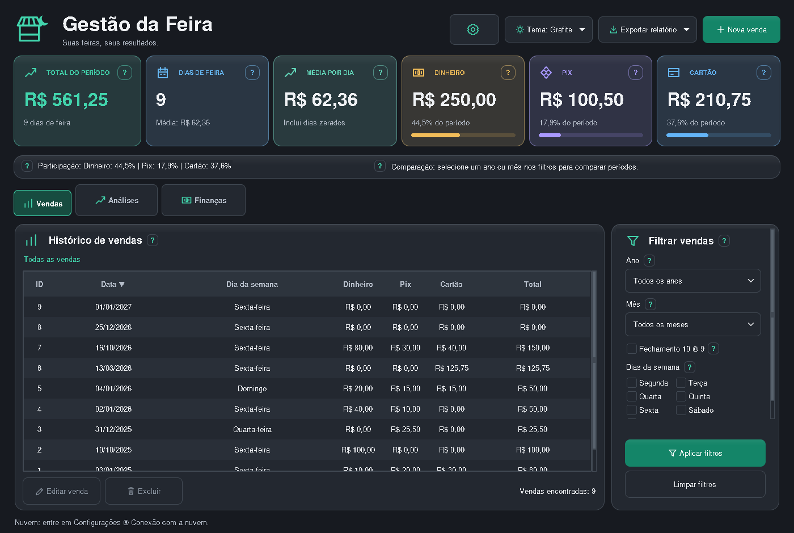

# Gestão da Feira

Um aplicativo para anotar as vendas das feiras, acompanhar os resultados e organizar as contas. Feito em Python, com Tkinter e SQLite.

## Usar no Windows

Baixe o arquivo **GestaoDaFeira-Windows-x64.zip** em [Releases](https://github.com/SilvioCf27/Programa-de-Vendas/releases/latest), extraia a pasta inteira e abra **GestaoDaFeira.exe**. A pasta `_internal` precisa ficar junto dele. Não é necessário instalar Python.

O programa começa vazio para quem está usando pela primeira vez. Se você já usa o Gestão da Feira, ele abre o banco local existente. Atualizar o programa não apaga suas vendas.

A partir da **v1.7.0**, abra **Configurações → Atualizações** para baixar e instalar
as próximas versões sem extrair o ZIP. O programa avisa ao abrir quando há uma
versão estável nova; a instalação só começa quando você confirma. Quem usa uma
versão anterior precisa baixar e extrair esta primeira atualização uma vez.
Veja os cuidados e a recuperação em [ATUALIZACOES.md](docs/ATUALIZACOES.md).

## Novidades do desktop 1.7.1

A tela inicial mostra a **Semana atual**, de segunda-feira até hoje, sem depender
dos filtros. Em **Análises → Resultados por semana**, consulte o histórico da
seleção aplicada. Dias zerados continuam contando como dias de feira.

Em **Configurações**, escolha o período da próxima abertura: fechamento atual
(padrão), mês atual, ano atual ou todas as vendas. A PWA permanece como está.
Quem já usa a versão 1.7.0 pode receber esta versão pelo próprio atualizador.

## O que dá para fazer

- Cadastrar, editar e excluir vendas por data, separando dinheiro, Pix e cartão.
- Filtrar por ano, mês, dia da semana ou fechamento de **10 a 09**.
- Comparar períodos e exportar vendas para CSV ou Excel.
- Registrar taxas, despesas e parcelas, acompanhando quanto falta para cobrir as contas.
- Criar backups e salvar cópias em uma pasta do Google Drive.

A aba **Vendas** mostra valores brutos. A aba **Finanças** desconta as taxas e despesas que você informar. Os botões **?** explicam os cálculos na própria tela.

O código atual oferece cinco temas: **Noite, Claro, Grafite, Areia escura e Aurora**.
Escolha no botão **Tema**; a preferência fica salva neste computador. Os cartões
mostram a participação de cada pagamento, e as barras de rolagem do histórico e
dos filtros aparecem apenas quando necessárias. Essas mudanças estão incluídas no executável **v1.6.2**.

## Finanças na versão 1.6.2

Compras usam o **valor total**, dividido automaticamente pelo número de parcelas.
Editar qualquer parcela abre a compra inteira, inclusive o histórico anterior.
O cálculo mantém a soma exata em centavos. No cartão, informe a **data da compra**:
a primeira fatura é calculada automaticamente e as duas datas são guardadas.
Para compartilhar a data original, execute [o SQL 006](supabase/migrations/006_datas_compras.sql) no Supabase.

Os filtros se adaptam a semana, mês, ano ou fechamento. Despesas usam dia, mês e
ano explícitos, com a data selecionada e a prévia das parcelas antes de salvar.
**Taxas da maquininha** permite preencher os descontos de vários dias em uma semana.
Totais históricos continuam preservados em uma área opcional.

Para configurar um novo fechamento e compartilhá-lo com o celular, execute apenas
[o SQL 005](supabase/migrations/005_fechamentos.sql) no projeto Supabase já existente.
A migração não altera vendas, despesas nem taxas. Até lá, o dia 09 continua sendo
a regra inicial. Leia [o guia de finanças e atualização](docs/FINANCAS.md).

## Segurança dos backups

A versão 1.6.2 reforça a validação de backups e caminhos de pastas, preservando
os arquivos de dados normais. Não exige uma migração SQL nova.
Leia [segurança e limites do backup](docs/SEGURANCA.md) para os achados, testes
e orientações de proteção das contas. As cópias não substituem antivírus nem
uma cópia desconectada do computador.

## Conheça a interface

As capturas abaixo usam somente exemplos fictícios. Veja [a galeria completa](docs/INTERFACE.md) para conhecer as análises, a comparação de períodos, as finanças e os temas.



## Onde estão os dados

No Windows, o banco fica em `%LOCALAPPDATA%\ProgramFeira\vendas.db`, fora da pasta do programa. A configuração do Drive e o tema também ficam nessa pasta. O repositório só contém um banco inicial vazio; vendas, planilhas, relatórios e backups pessoais não devem ser enviados ao GitHub.

Os testes criam dados fictícios em pastas temporárias. Não usam o banco pessoal e não preenchem o banco distribuído com o aplicativo.

## Executar pelo código

Instale Python 3.13 com Tcl/Tk e SQLite 3.50.2 ou mais recente. Na pasta do projeto:

```sh
python -m pip install -r requirements.txt
python -m ProgramFeira.main
```

No Windows também é possível usar `py` no lugar de `python`. No Linux, pode ser necessário instalar `python3-tk`. O pacote openpyxl é usado apenas na exportação Excel.

Para atualizar o código, feche o programa e execute `git pull --ff-only`. Um executável já baixado não muda com esse comando: para atualizá-lo, baixe a nova versão em Releases.

## Guias

- [Vendas, finanças e backups](docs/USO.md)
- [Conferir e recuperar um backup](docs/RECUPERACAO.md)
- [Executável: instalar, atualizar e gerar](docs/EXECUTAVEL.md)
- [Estrutura do projeto e testes](docs/DESENVOLVIMENTO.md)

## Versão para celular — em desenvolvimento

A PWA está em `web/`, com login pessoal, vendas e finanças online. O código atualizado do desktop permite migrar os dados e sincronizar inclusões, edições e exclusões automaticamente a cada minuto enquanto estiver aberto e autenticado, ou pelo botão **Sincronizar agora**, com backup e proteção contra conflitos. Configure seu próprio projeto Supabase e a hospedagem no Cloudflare Pages. A aba Finanças permite consultar saldo, despesas, parcelas e taxas. A aba Análises mostra pagamentos e dias da semana, além de comparar datas, meses, fechamentos e intervalos. A tela web consulta a nuvem automaticamente a cada minuto enquanto estiver visível, preservando formulários e filtros em preparação. O executável Windows v1.6.2 inclui a integração com a nuvem e a recuperação da sessão protegida.

O guia de configuração e os limites desta etapa estão em [CELULAR.md](docs/CELULAR.md).

A versão 1.2.0 acrescenta ensaio de recuperação, revisão das versões em conflito,
gráficos por mês/fechamento e exportação CSV/Excel no celular. Os dados e as
configurações existentes são preservados. Os testes usam bancos temporários e
dados fictícios; o banco público distribuído continua vazio.

Na versão 1.2.2, a engrenagem ao lado do nome abre Configurações, com as funções
de backup, nuvem e informações do programa. Os botões **?** mostram dicas ao passar
o mouse. **Verificar integridade do backup** confere uma cópia sem alterar o banco
em uso; **Restaurar backup** aplica a cópia escolhida.
