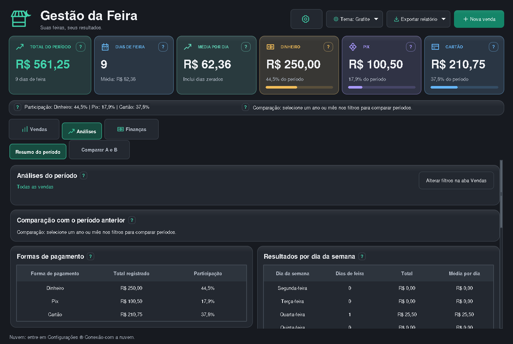
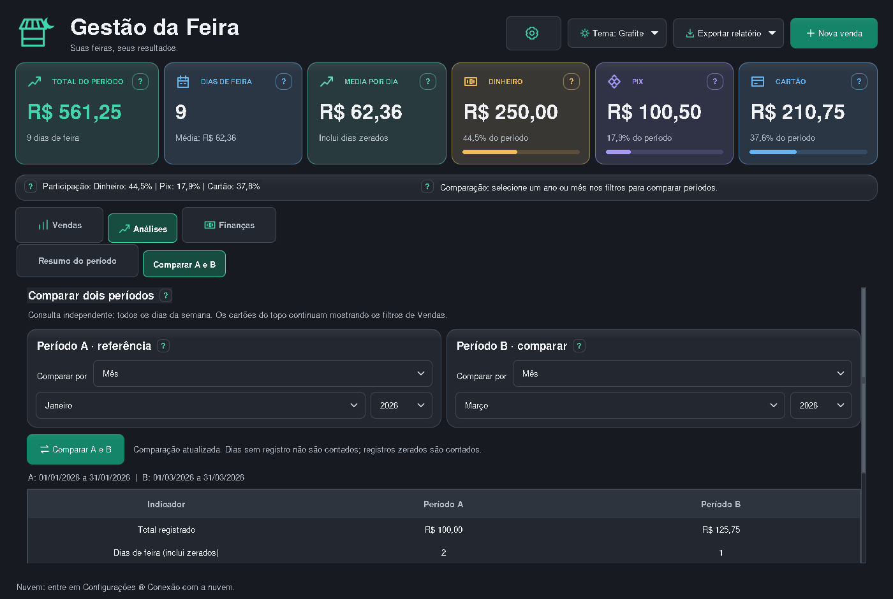
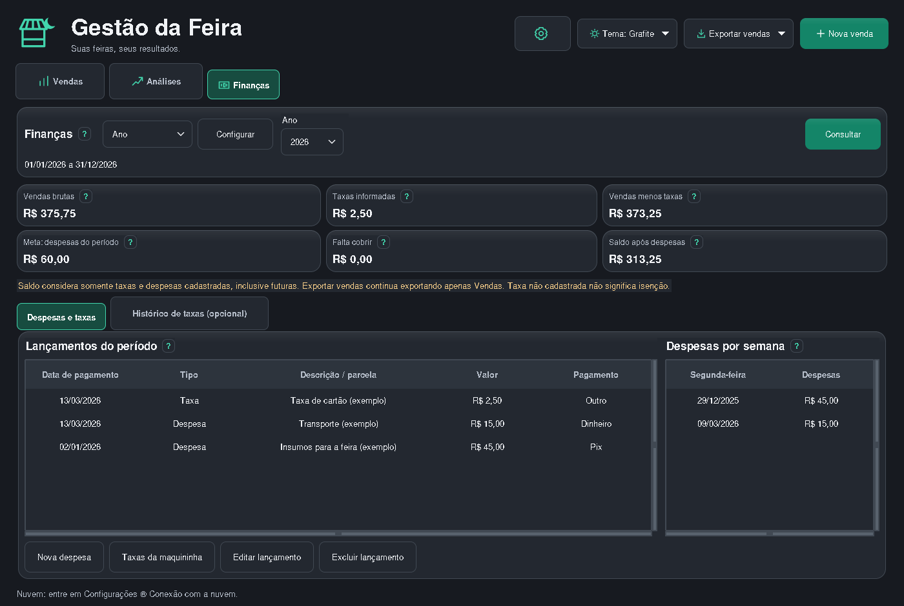
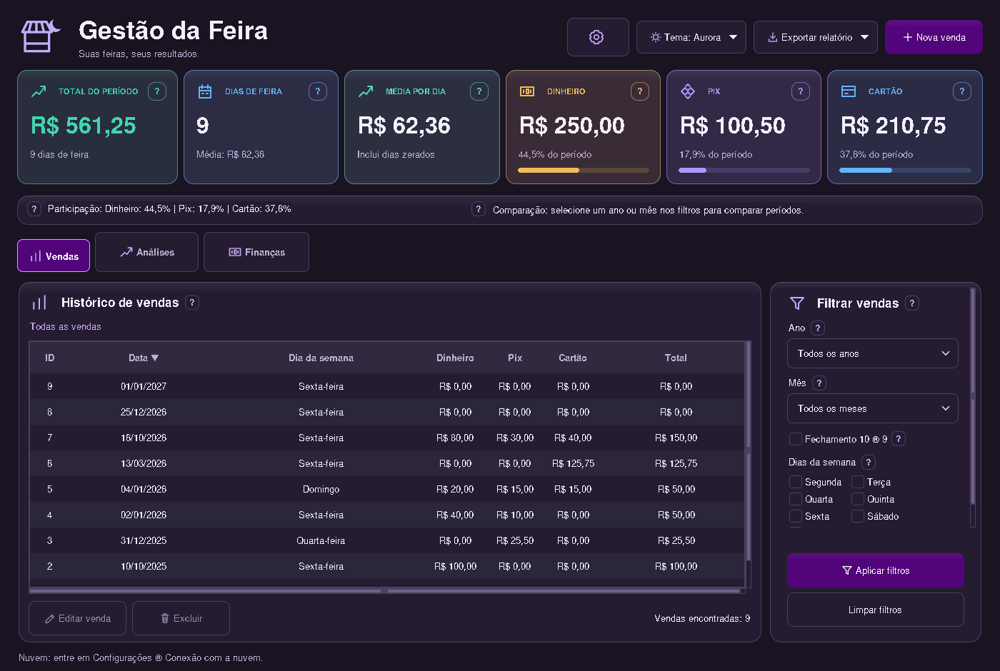
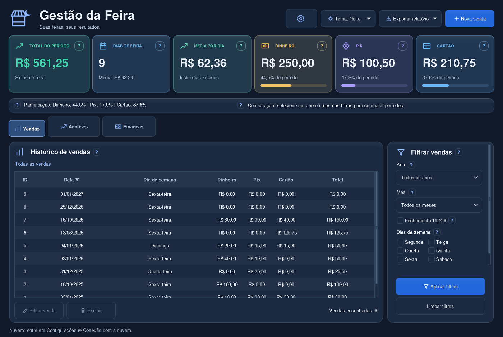
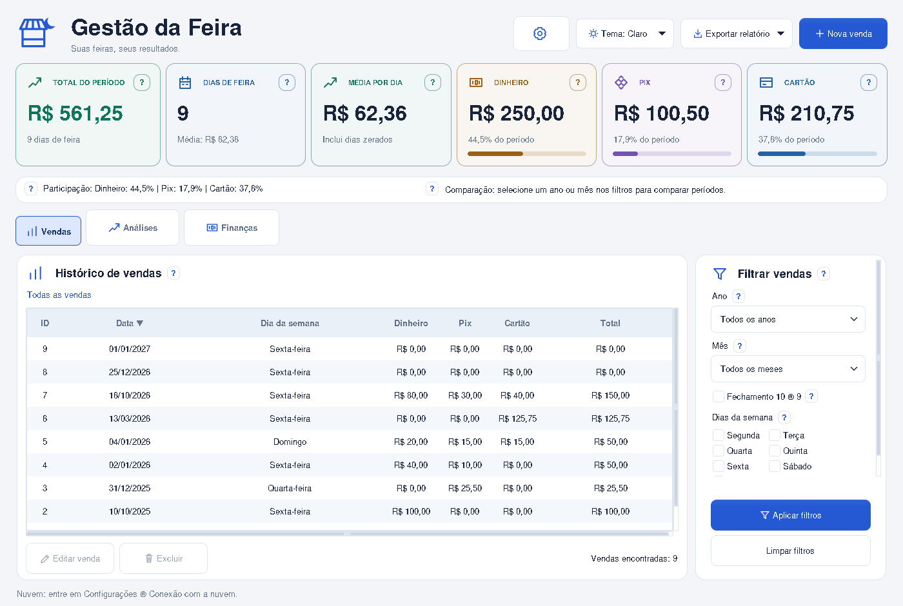
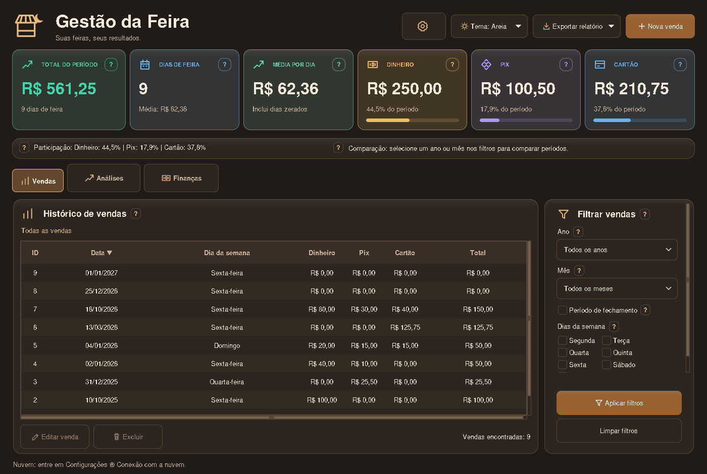
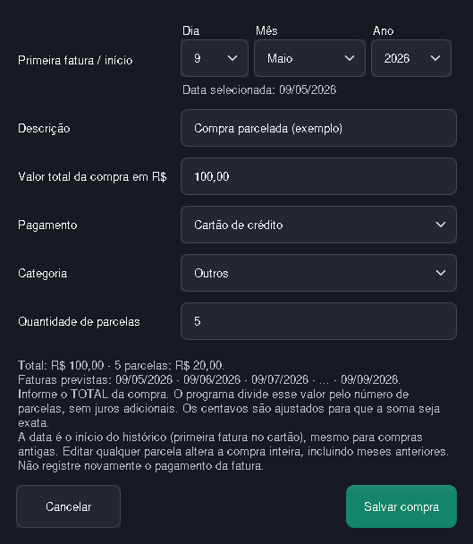

# Conheça o Gestão da Feira

As capturas mostram o aplicativo desktop v1.6.2 com **dados fictícios**.
Os exemplos não fazem parte do banco distribuído. Fontes e detalhes de renderização
podem variar conforme o sistema e a escala da tela.

## Vendas e filtros

Registre dinheiro, Pix e cartão por data. Os indicadores acompanham os filtros
aplicados: ano, mês, fechamento de 10 a 09 e dias da semana. Dias de feira com
valores zerados também entram na contagem. Exporte a consulta para CSV ou Excel.

## Análises

Veja a participação das formas de pagamento, resultados por dia da semana e a
evolução das vendas, sempre com a seleção aplicada em Vendas.

## Comparação de períodos

Compare duas datas, meses, fechamentos ou intervalos. Essa consulta tem seus
próprios seletores e não muda os filtros da aba Vendas.

## Finanças

Registre despesas, parcelas e taxas. Acompanhe as vendas menos taxas, a meta de
cobertura das despesas e o saldo do período. O saldo considera somente os valores
cadastrados; não é uma consulta ao banco nem lucro contábil.

## Escolha seu tema

O botão **Tema** muda a paleta e salva a preferência neste computador.
O Grafite aparece na primeira captura. As outras opções são:

### Aurora

Roxo `#52057B` nas ações principais, com textos claros para leitura.

### Noite

### Claro

### Areia escura

## Dados e segurança das cópias

A engrenagem abre backups, recuperação e conexão com a nuvem. O banco de uso fica
fora da pasta do programa; atualizar o aplicativo preserva os dados. Os botões
**?** explicam as funções. Veja [o guia de uso](USO.md) e [a recuperação de backup](RECUPERACAO.md).

## Compra parcelada

Mesmo abrindo uma parcela intermediária, a edição mostra o total da compra,
a data da compra (ou a fatura de um registro antigo) e a quantidade de parcelas. A prévia mostra os valores
calculados, e salvar atualiza o histórico inteiro da compra.

