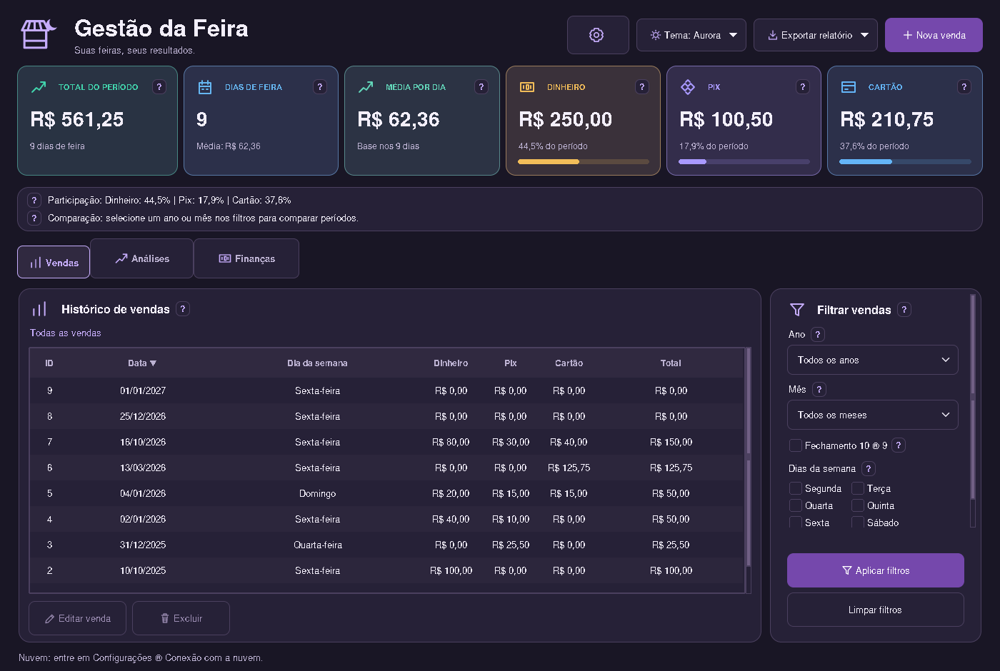

# Prévias atualizadas

Interface real com dados fictícios. Apenas imagens nesta branch; o código em main não foi alterado.

Nova proposta baseada na referência: cartões com cores por indicador, ícones maiores, contexto abaixo dos valores, barras arredondadas de participação, ícones nas abas e cabeçalho reorganizado. Tabela e filtros preservam as funções atuais. Busca, paginação e ações por linha da imagem de referência não foram acrescentadas nesta etapa visual. Capturas em 1400 × 940, com dados fictícios.

## Noite

## Claro

## Grafite

## Areia escura

## Aurora

