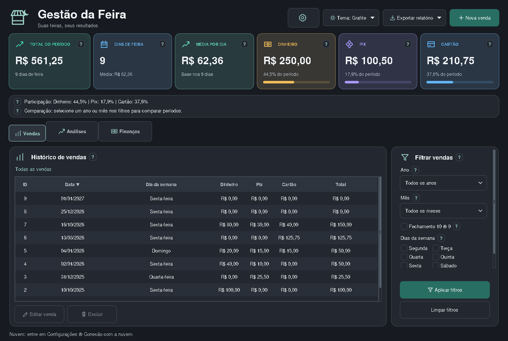
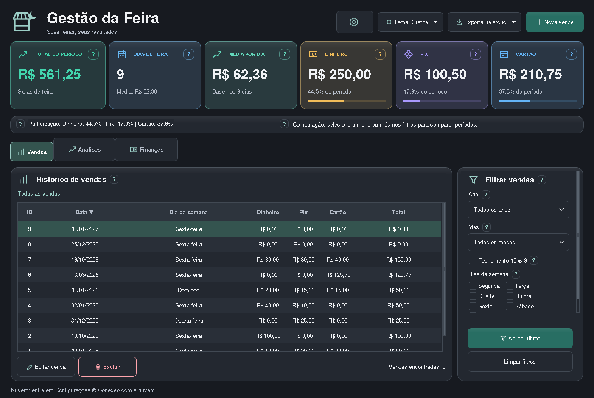

# Nova rodada de acabamento

Capturas reais em 1400 × 940, com dados fictícios. Apenas imagens nesta branch; código em main intacto.

Ajustes desta rodada: totais maiores e destaque colorido no faturamento, relevo sutil na borda superior, ajudas dos cartões com contornos por indicador, abas com seleção mais evidente, cabeçalho da tabela mais legível e contagem dos registros ao lado das ações. Em janelas largas, participação e comparação ficam lado a lado; em janelas menores, voltam a duas linhas.

## Comparação com a rodada anterior

### Antes

### Agora

### Seleção de uma venda

## Os cinco temas

## Noite

## Claro

## Grafite

## Areia escura

## Aurora

