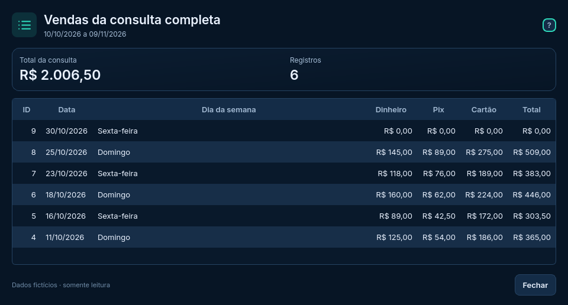
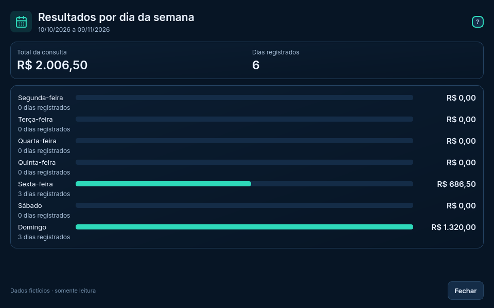
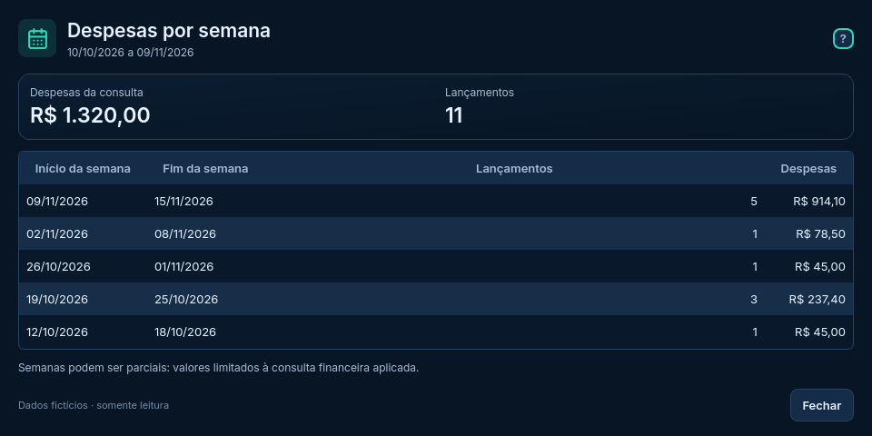
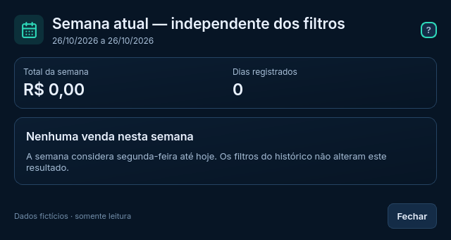

# Janelas secundárias — continuidade da reforma

**Atualização da cronologia:** a estética e a escolha PySide6 foram aprovadas. A Etapa 4 começou pela [integração funcional de Vendas em banco separado](../../reforma_desktop/README.md). A seção 19 do plano contém o andamento atual; esta página preserva o relatório visual anterior.

Esta entrega pertence às **Etapas 2/2A de prototipação e revisão**, conforme a seção 18 do [plano principal](../../docs/PLANO_REFORMA_DESKTOP.txt). A aprovação visual das telas principais foi registrada separadamente da escolha da ferramenta. Não houve migração funcional, alteração da PWA ou nova versão estável.

As três telas principais permaneceram visualmente inalteradas: suas capturas foram renderizadas e comparadas pixel a pixel com as da entrega anterior neste ambiente Linux, sem diferenças. A intervenção está nos detalhes abaixo, todos com dados fictícios e sem acesso ao banco pessoal.

## Vendas da consulta completa

A lista simples passou a usar uma tabela de leitura com ID, data, dia da semana, dinheiro, Pix, cartão e total. A janela mostra contagem e total da consulta aplicada; a página visível do histórico e os filtros ainda não aplicados não limitam os registros. Há ordenação por cabeçalho, com datas e valores ordenados por seus tipos, sem reordenar os dados da tela de origem.



## Resultados por dia da semana

Mantém os sete dias, com total e quantidade de dias registrados. As barras são proporcionais ao maior total da consulta, como explicado na ajuda; zero não recebe preenchimento. Um registro de venda zerada conta como dia registrado, enquanto ausência de registro não conta.



## Despesas por semana

Intervalos completos de segunda a domingo, quantidade de lançamentos e despesas em tabela. Preserva o critério anterior da demo: agrupar pela data da fatura/pagamento, excluir taxas e incluir somente despesas dentro da consulta financeira aplicada, independente de Vendas. Uma semana pode ultrapassar as bordas do filtro; seu valor contém apenas os lançamentos do recorte.



## Semana atual independente dos filtros

Janela compacta quando não há vendas, com intervalo, total zero e quantidade zero. Quando há registros, apresenta também a distribuição por pagamento e a tabela das vendas. Mantém segunda-feira até hoje, sem datas futuras nem influência dos filtros do histórico.

A demo usa o relógio fixo em 26/10/2026, segunda-feira; por isso a captura mostra o estado vazio. O estado com vendas foi verificado nos testes usando um relógio fictício de domingo, sem modificar os exemplos distribuídos.



## Padrão compartilhado e escopo limitado

Os detalhes reutilizam cabeçalho, fonte Inter, paleta Noturno, ícones Lucide, ajudas, margens, estados vazios e botão Fechar. Tabelas usam modelo de leitura sob demanda, seleção por teclado e rolagem. Escape fecha a janela e retorna à tela sem descartar filtros pendentes, seleção ou paginação.

Também foram ajustados os resultados de formas de pagamento e evolução para tabelas do mesmo padrão, além das janelas de notas já existentes. Notas de taxas históricas e fechamento continuam identificadas como informações demonstrativas; não foram inventados registros nem implementados novos cadastros.

Componentes:

- `componentes_noturno.py`: funções visuais já existentes, compartilhadas entre telas e janelas, sem redesenhar os componentes.
- `janelas_noturno.py`: `JanelaDetalhe`, `ModeloDetalhe`, estados vazios e construtores das consultas de leitura.
- `noturno_demo.py`: abre os detalhes usando snapshots das seleções aplicadas; fecha e libera as janelas sem mudar o estado da origem.
- `tema_noturno.py`: estende o mesmo acabamento de tabela para `QTableView`.
- `test_janelas_noturno.py`: regressões das consultas, navegação e casos de volume.
- `validar_escala_noturno.py`: inclui as quatro janelas na renderização em processos separados.

## Executar e conferir

Na cópia de estudo do VS Code:

```powershell
git pull --ff-only origin reforma/estudo-interface
.\.venv-estudo\Scripts\python.exe prototipos/reforma/noturno_demo.py
```

Acesse:

1. **Análises → Lista de vendas da seleção**.
2. **Análises → Resultados por dia da semana**.
3. **Finanças → Despesas por semana**.
4. **Vendas → Ver detalhes da semana**.

Confira total/quantidade, selecione e ordene linhas, use Tab e Escape, abra uma ajuda por clique e redimensione. Altere os filtros do histórico sem aplicar e confirme que o detalhe continua usando a seleção aplicada. Feche as janelas e confira se a seleção e a consulta da tela anterior foram preservadas.

Para abrir diretamente um dos detalhes, os argumentos `--detalhe vendas`, `--detalhe dias`, `--detalhe despesas` e `--detalhe semana` estão disponíveis. `--captura caminho.png` captura a janela executada. As dependências são as mesmas da demo anterior; caso falte PySide6, veja o [guia do VS Code](GUIA_VSCODE.md).

## Verificação e limites

**Aprovados no Linux:**

- 31 testes: 19 da revisão existente, oito das janelas e quatro dos primeiros protótipos.
- 63 cenários renderizados: 27 das três telas principais e 36 das quatro janelas secundárias, com três tamanhos lógicos e fatores Qt 1, 1,25 e 1,5. Sem corte horizontal externo do conteúdo, com rolagem quando necessária.
- Casos de 5.000 registros e valores elevados, consultas vazias, dias sem movimento e registro zerado, semana com e sem vendas, ordenação numérica/datas, consulta aplicada, independência financeira/semanal, Tab e Escape.
- Comparação de pixels das telas principais com a entrega anterior: sem diferenças neste ambiente.
- Cópia da versão 1 do plano conferida byte a byte contra o commit original `2a42f43`; SHA-256 registrado no plano atual.

Os [resultados de escala](ESCALAS_NOTURNO.json) são **simulação em Qt/Linux**, não validação no Windows. Não verificam automaticamente cada glifo, leitor de tela ou interação. Windows real/DPI 100/125/150%, acessibilidade completa, distribuição, temas equivalentes e integração funcional continuam pendentes. Não foram repetidos testes de produção ou de pacote, pois esses arquivos não mudaram.

## Retomada do plano

Esta página documenta a entrega visual, agora aprovada pelo usuário junto com a direção das três telas principais. Correções pontuais de legibilidade/comportamento durante testes Windows continuam permitidas.

A comparação técnica foi concluída e a recomendação está em [DECISAO_TECNICA.md](avaliacao/DECISAO_TECNICA.md). O estado atual está na seção 18 do plano: Etapas 2/2A visualmente aprovadas; Etapa 3 aguarda aprovação explícita da ferramenta; Etapa 4 não iniciada. O programa estável, seus dados e a PWA permanecem preservados.
