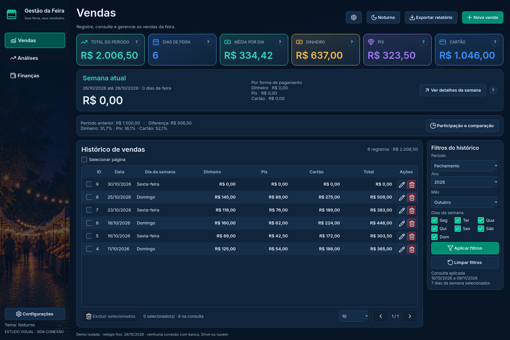
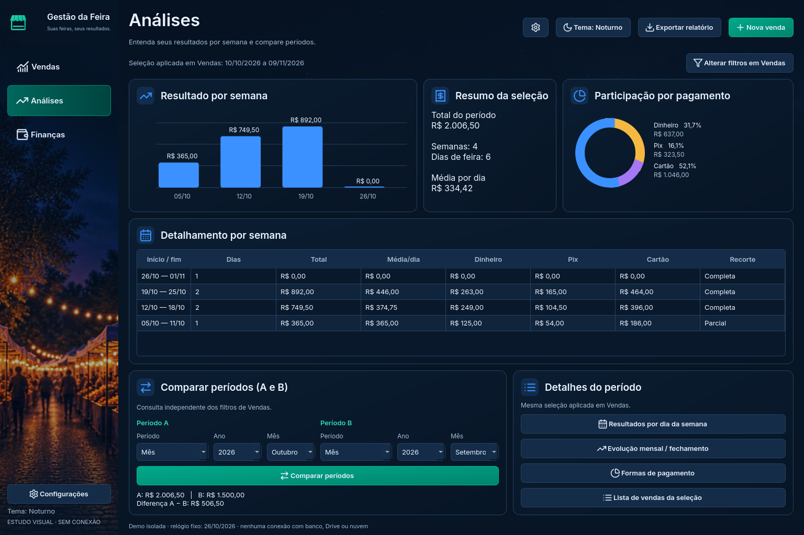
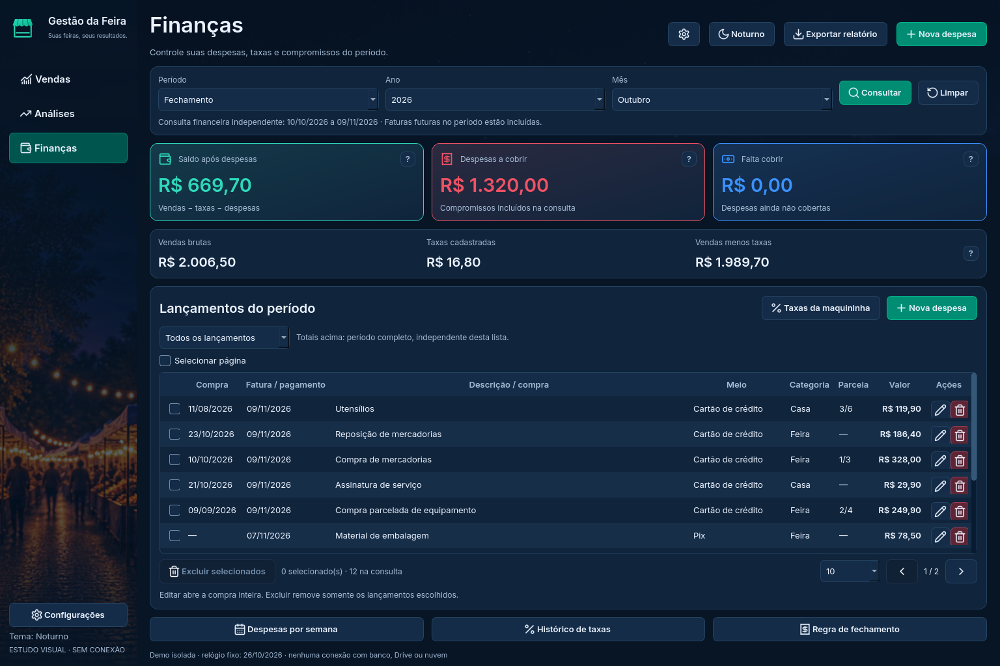

# Revisão Noturno — demonstração para avaliar no VS Code

**Atualização da cronologia:** a estética e a escolha PySide6 foram aprovadas. A Etapa 4 começou pela [integração funcional de Vendas em banco separado](../../reforma_desktop/README.md). A seção 19 do plano contém o andamento atual; esta página preserva o relatório visual anterior.

A comparação técnica está em [DECISAO_TECNICA.md](avaliacao/DECISAO_TECNICA.md). A aprovação visual não autoriza a migração.

**Visual aprovado pelo usuário:** [janelas secundárias refinadas](JANELAS_SECUNDARIAS.md). As três telas principais abaixo foram preservadas. O estado oficial da reforma está na seção 18 do [plano principal](../../docs/PLANO_REFORMA_DESKTOP.txt).

Esta revisão aplica a direção das três imagens enviadas pelo usuário. **É uma demo isolada com dados fictícios; o aplicativo instalado e a PWA continuam inalterados.** A implementação visual usa PySide6 para avaliar o desenho. Isso não encerra a comparação técnica com Tkinter nem autoriza a substituição do desktop.

## Refinamento orientado pelo Read.txt completo

A rodada atual segue as prioridades do documento enviado: comparação anterior com média e variação real, pagamentos semanais alinhados com ícones, roscas com legendas em colunas, gráfico semanal com escala monetária e intervalos, resumo em valores separados, tabela semanal com altura conforme as linhas, seletores A/B distintos e acessos com descrições. Em Finanças, os três valores secundários ganharam ícones e separadores, preservando a consulta independente.

O acabamento compartilhado foi centralizado em `tema_noturno.py`. Os grupos se empilham em janela estreita, mantendo a rolagem e os acessos. Não há substituição da interface estável nem dos cinco temas atuais por esta demo. Veja o [relatório do Read.txt, arquivos e limites](RELATORIO_READ.md).

## Rodada anterior de fidelidade

[Comparação com as referências e limites desta rodada](COMPARACAO_VISUAL.md).

Cartões de pagamento agora mostram participação e barras; a faixa semanal usa foto recortada proporcionalmente. Comparação anterior e participação voltaram a ser painéis distintos. Painéis mais escuros, ícones em blocos coloridos, filtros compactos, ações de edição/exclusão e acessos inferiores de Finanças foram refinados. As capturas abaixo mostram a revisão mais recente, incluindo as orientações do Read.txt completo.

## Vendas

Navegação lateral, seis indicadores, semana atual independente do filtro e histórico com filtros à direita. A largura da coluna de dia da semana não recebe todo o espaço restante. Seleção múltipla, ações por linha e paginação estão disponíveis.



## Análises

Tela própria com resultado semanal, resumo e participação, tabela de semanas, comparação A/B independente e acessos aos detalhes. O resumo segue a seleção aplicada em Vendas. O comparador demonstra dia, mês, fechamento e intervalo; os números são calculados sobre os exemplos, não copiados da imagem gerada.



## Finanças

Consulta própria adaptativa (semana/mês/ano/fechamento), três indicadores compactos e três valores secundários. Lista com data da compra e data da fatura/pagamento separadas, categoria, parcelas e ações. “Falta cobrir” explica despesas ainda não cobertas; não usa o texto incorreto de recebíveis da referência. Os totais consideram o período completo, mesmo ao filtrar a lista por despesa, taxa ou parcela.



## Como executar

Na cópia de estudo já preparada, feche a demo anterior e rode no terminal do VS Code:

```powershell
git pull --ff-only origin reforma/estudo-interface
.\.venv-estudo\Scripts\python.exe -m pip install -r prototipos/reforma/requirements.txt
.\.venv-estudo\Scripts\python.exe prototipos/reforma/noturno_demo.py
```

Ou use **Executar e Depurar → Reforma — identidade Noturno (nova demo) → F5**, com o interpretador `.venv-estudo\Scripts\python.exe` selecionado.

Se ainda não tiver a cópia e o ambiente de estudo, siga o [guia completo do VS Code](GUIA_VSCODE.md). As dependências continuam no mesmo `requirements.txt`; nenhuma foi acrescentada ao aplicativo estável. Fontes, fundos e ícones estão incluídos e são carregados localmente.

## O que testar

1. Maximize a janela, visite as três áreas e confira bordas, dimensões dos blocos, alinhamento, tipografia e leitura. O fundo é decorativo e recebe escurecimento para manter contraste.
2. Em Vendas, altere o período e veja o aviso de consulta pendente. Aplicar atualiza os indicadores e Análises; Limpar retorna a todas as vendas. A semana atual permanece independente.
3. Troque “10” por “5” na lista: haverá mais de uma página nos exemplos. Selecione registros ou use **Selecionar página**. Ao mudar de página ou aplicar consulta, a seleção é limpa; mudar de área preserva o estado da tela.
4. Tente excluir os selecionados e primeiro cancele. Depois confirme uma exclusão: somente os IDs escolhidos saem do estado fictício e os indicadores são recalculados. **Fechar e reabrir a demo repõe todos os exemplos.**
5. Em Finanças, escolha o tipo de consulta e os campos adaptados, clique em Consultar e compare com Vendas. Essa consulta é independente. Filtrar a lista por Taxas não muda os indicadores do período completo.
6. Em Análises, compare A e B e abra os detalhamentos. Os registros zerados contam como dia de feira; a semana incompleta do recorte está identificada.
7. Passe o mouse nos pontos de interrogação ou abra a ajuda por clique/teclado. Anote tela, elemento, problema e resultado desejado; informe resolução e escala do Windows.

## O que ainda não representa o programa real

- Nova venda, nova despesa, editar, exportar, temas e configurações mostram avisos de prévia. Os formulários não foram reconstruídos nesta revisão. Ajustes históricos de taxas e configuração de fechamento ainda são acessos demonstrativos.
- Sem login, SQLite, Drive ou rede; nada é persistido. As exclusões da demo não testam transações reais, conflitos ou exclusão sincronizada: esses ensaios pertencem à integração posterior.
- A demo usa um calendário **fixo em 26/10/2026**, com exemplos concentrados em setembro e outubro. A semana atual começa na segunda 26/10 e não tem vendas até esse dia; a venda zerada de 30/10 aparece no mês, mas não na semana até hoje. Outros recortes podem retornar zero por ausência de exemplos.
- Fechamento demonstrativo fixo no dia 09 (Outubro = 10/10 a 09/11). O histórico de regras do programa real não foi importado nem alterado. Nenhum valor de compra real foi recalculado.
- O desenho segue as referências, mas não é uma reprodução pixel a pixel: campos foram adaptados, erros corrigidos, os recursos individuais diferem um pouco da prancha e efeitos decorativos foram simplificados. A preferência visual final continua com o usuário.
- Apenas Noturno aplicado nesta revisão. Outros temas, pacote Windows, atualizador e todas as funções reais ainda aguardam as etapas do plano.
- Sem geração de release, alteração da versão 1.7.1 ou instalação via atualizador.

## Janela menor

Em 1.280 × 800, os seis indicadores se reorganizam em duas linhas. Há rolagem vertical quando necessária, mantendo acesso ao conteúdo; a tela inteira não fica cortada horizontalmente. As tabelas podem rolar internamente quando houver mais linhas ou colunas que o espaço disponível. Não se presume que caberá tudo sem rolagem em qualquer escala.

[Ver Vendas em janela menor](imagens/noturno-vendas-menor.png)

## Verificações da rodada anterior das telas principais

- **19 testes da revisão Noturno passaram** no Linux com Python 3.13.5 / PySide6 6.10.2: totais em centavos, períodos, zero/futuro, isolamento, seleção por página, totais independentes da paginação, consultas, A/B, cancelamento e confirmação de exclusão, última página, estado vazio, atualização financeira, navegação e largura menor.
- **4 testes das demos anteriores passaram novamente**, preservando a comparação.
- PNGs de recursos conferidos; SVGs e fontes locais, com licenças incluídas. Capturas feitas da interface executada, em 1.536 × 1.024 e 1.280 × 800; não são imagens geradas para simular o resultado.
- Não foram executados os testes completos de produção nesta entrega: seu código não foi modificado.
- **27 cenários de renderização passaram:** três áreas × três tamanhos lógicos de janela (1.536 × 1.024, 1.280 × 800, 1.000 × 700) × três fatores Qt (1, 1,25 e 1,5). Não houve corte horizontal externo; o conteúdo pode rolar verticalmente. Isso não verifica automaticamente todos os textos nem substitui DPI e interação em Windows real. Resultados em [ESCALAS_NOTURNO.json](ESCALAS_NOTURNO.json).
- **Pendentes:** Windows real em 100/125/150%, teclado e leitores de tela em revisão completa, outros temas, integração com o banco e a sincronização, empacotamento e atualização. Os testes Linux não substituem esses ensaios.

Para reproduzir os testes desta revisão em uma sessão gráfica Windows:

```powershell
.\.venv-estudo\Scripts\python.exe prototipos/reforma/test_noturno.py
```

Próximo passo: avaliação visual local do usuário, ajustes de enquadramento e dos formulários; concluir a escolha técnica e os ensaios previstos antes de conectar a interface à aplicação real.
