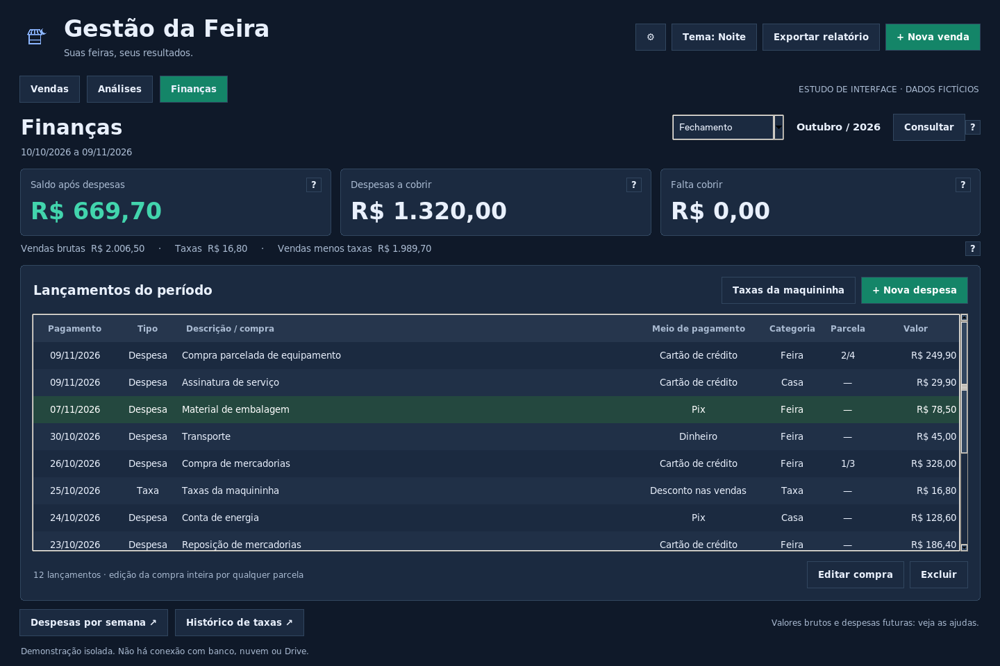
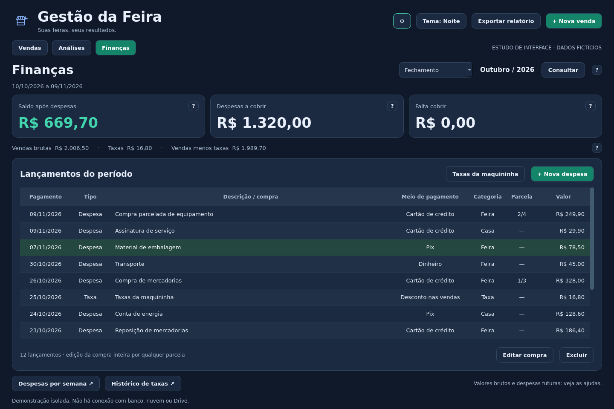

# Estudos da reforma do desktop

**Rodada atual:** [Etapa 6 — entrada de validação](../../reforma_desktop/VALIDACAO_ONLINE.md), seção 32 do [plano principal](../../docs/PLANO_REFORMA_DESKTOP.txt). A [comparação técnica](avaliacao/DECISAO_TECNICA.md) permanece como base da decisão.

A revisão estética e a escolha PySide6 foram aprovadas explicitamente. A Etapa 4 começou: [primeira integração de navegação e Vendas](../../reforma_desktop/README.md). O andamento atual está na seção 32 do plano. Os estudos abaixo não substituem o programa funcional 1.7.1.

- [Galeria comentada: Vendas, Análises e Finanças](REFERENCIA_VISUAL.md)
- [Briefing completo em TXT para enviar à outra IA](BRIEFING_IDENTIDADE_VISUAL.txt)
- [Passo a passo para executar e atualizar no VS Code](GUIA_VSCODE.md)

Esta frente contém o levantamento inicial e dois protótipos reais de interface,
com os mesmos dados inventados, período e dimensões. A versão estável, seu banco,
a sessão, a sincronização e a PWA não foram alterados.

## Referências recebidas

A paleta Noturno, a fonte Inter e os recursos gráficos individuais foram confirmados. Veja a [identidade consolidada e a conferência dos arquivos](IDENTIDADE_VISUAL.txt). As capturas abaixo ainda mostram a primeira demo, **anterior à aplicação dessa identidade**.

## A proposta de Finanças

- Tela própria, sem repetir os cartões de vendas.
- Período no cabeçalho da área e três indicadores principais: saldo, despesas e falta cobrir.
- Vendas brutas, taxas e vendas menos taxas em uma linha secundária, sem eliminar valores.
- Lançamentos ocupando a largura disponível; ações de despesa, taxa, edição e exclusão próximas à lista.
- Despesas por semana e histórico de taxas com acessos próprios, em vez de uma coluna permanente e abas aninhadas.
- Explicações em `?`, disponíveis por mouse e clique. No estudo Qt há também nome acessível; a revisão completa de teclado fica para a implementação.
- Um único nível de navegação. O menu duplicado Exportar não é reproduzido; o botão superior permanece.

**O cabeçalho é uma referência de contexto, não uma proposta de reformar os blocos superiores aprovados.** A entrega final deverá reutilizar a aparência e os indicadores aprovados na tela inicial. Os esboços de Vendas e Análises servem para avaliar a separação das áreas; ainda não são suas telas definitivas.

## Tkinter refinado

Clique na imagem para ampliar. A captura tem 1.440 × 960 pixels.



## PySide6 / Qt

A mesma proposta de hierarquia e os mesmos lançamentos, com controles Qt.



## Contexto de Análises

Os resultados semanais são a entrada principal; comparação A/B e detalhes do período têm acessos explícitos, sem outra fileira de abas. Nesta prévia esses acessos mostram avisos de posicionamento, não os formulários finais.

[Tela de contexto em Tkinter](imagens/tkinter-analises.png) · [Tela de contexto em PySide6](imagens/pyside-analises.png)

## O que é interativo nesta entrega

- Alternar entre Vendas, Análises e Finanças, preservando a seleção da tabela financeira.
- Selecionar Fechamento, Mês, Ano ou Semana e clicar em Consultar. A demonstração usa datas fixas de outubro de 2026; o mês e o ano ainda não são editáveis.
- Selecionar e rolar lançamentos; abrir ajudas e as prévias de despesas por semana e taxas históricas.

Cadastros, edição, exclusão, exportações, temas, configurações, comparação A/B e detalhes gerais do período **ainda não estão conectados às funções do aplicativo**. Seus botões sinalizam essa limitação. Os valores e categorias são exclusivamente fictícios; “Taxa” na coluna de classificação é uma representação do estudo, não uma nova categoria obrigatória do banco.

Os protótipos não importam `ProgramFeira`, não abrem SQLite, não autenticam e não usam a rede. A biblioteca PySide6 está apenas nas dependências deste estudo. Não foi adicionada aos requisitos do aplicativo estável.

## O que foi medido

O [relatório de medições](MEDICOES.md) registra abertura, entrada e retorno às áreas e a atualização de todas as vendas. Foram usadas três repetições com 224 e 5.000 vendas fictícias, mais lançamentos financeiros.

O principal gargalo observado nesse ensaio foi o dimensionamento das colunas de Vendas, não a leitura do banco. Isso sugere uma otimização de implementação que vale para as duas ferramentas. Não prova que todo o lag percebido no PC tenha a mesma causa.

Os estudos de interface são menores que o aplicativo inteiro. Seus tempos e consumo de memória não permitem afirmar que uma migração tornará o programa completo mais rápido.

**Ainda pendentes:** Windows, escalas de 100/125/150%, cinco temas, formulários completos, pacote/atualizador com Qt e todos os caminhos do inventário. As capturas foram feitas no Linux a 96 DPI com fonte equivalente comum; não representam a renderização final do Windows. A primeira tentativa com Tk 9 neste ambiente não encontrou a fonte escolhida; por isso a comparação publicada usa Tk 8.6 e PySide6 no mesmo Python 3.13, com tamanhos coerentes.

## Executar os estudos, se quiser interagir

Não é necessário instalar nada para comparar as imagens acima.
Para executar, use uma cópia separada desta frente e um Python com Tkinter.
Recomenda-se Python 3.13 x64; as demos não dependem do runtime embutido no executável estável.

O Tkinter interativo usa apenas a biblioteca padrão:

```sh
python prototipos/reforma/tkinter_demo.py
```

Para Qt e para as ferramentas de medição, crie um ambiente separado. Exemplo no Windows, a partir da raiz dessa cópia do projeto:

```powershell
py -3.13 -m venv .venv-estudo
.venv-estudo\Scripts\python -m pip install -r prototipos/reforma/requirements.txt
.venv-estudo\Scripts\python prototipos/reforma/pyside_demo.py
```

Fechar as demos descarta a interação; nenhuma venda é gravada. Não substitua a pasta do programa instalado e não use o atualizador para instalar estes estudos.

## Arquivos e próxima decisão

- [Plano da reforma atualizado](../../docs/PLANO_REFORMA_DESKTOP.txt)
- [Mapa das funções a preservar](MAPA_FUNCOES.txt)
- [Resultados e limites das medições](MEDICOES.md)
- [Medições brutas do programa atual](BASE_MEDICOES.json)
- [Medições brutas dos protótipos](PROTOTIPOS_MEDICOES.json)

O andamento atual e a próxima atividade estão na seção 17 do [plano principal](../../docs/PLANO_REFORMA_DESKTOP.txt). A preferência visual não substitui a decisão técnica nem autoriza alterar cálculos ou excluir funções. As janelas secundárias desta rodada estão na [galeria da entrega](JANELAS_SECUNDARIAS.md).
