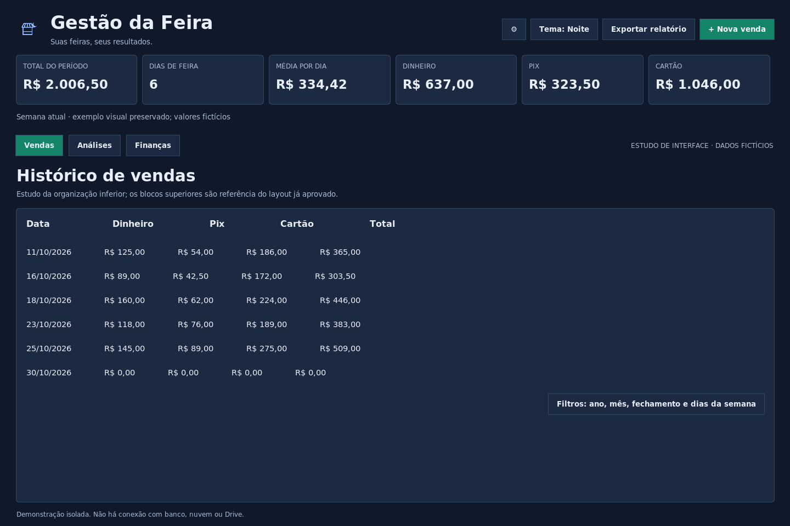
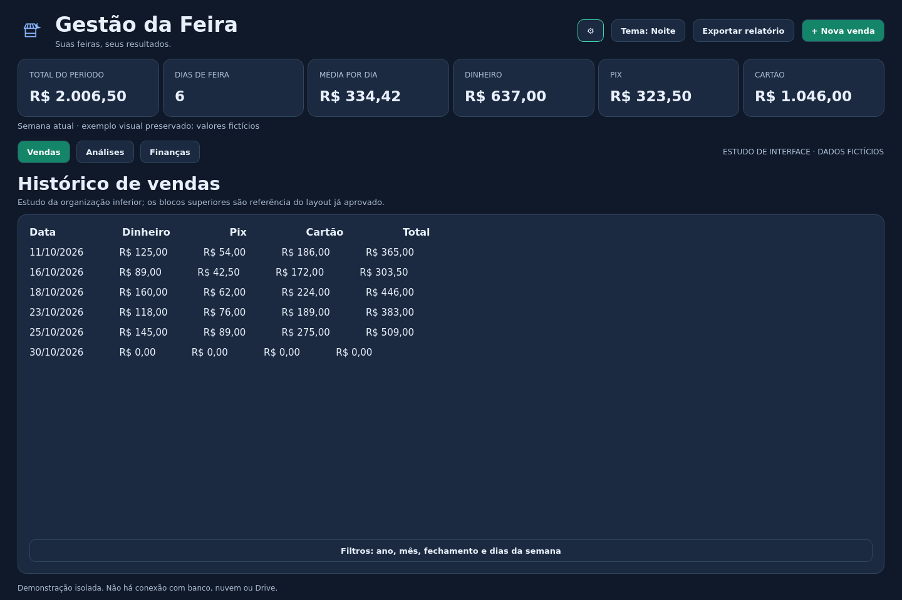
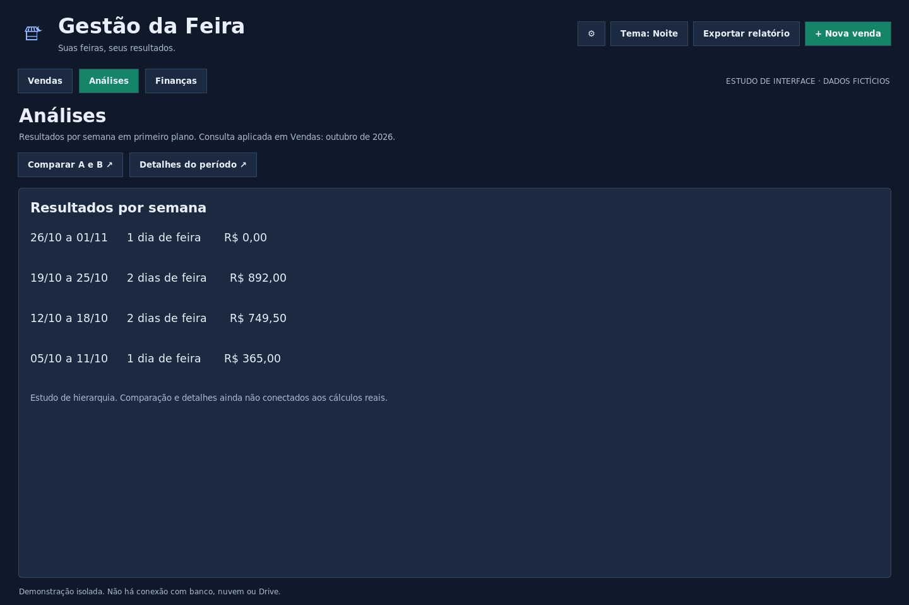
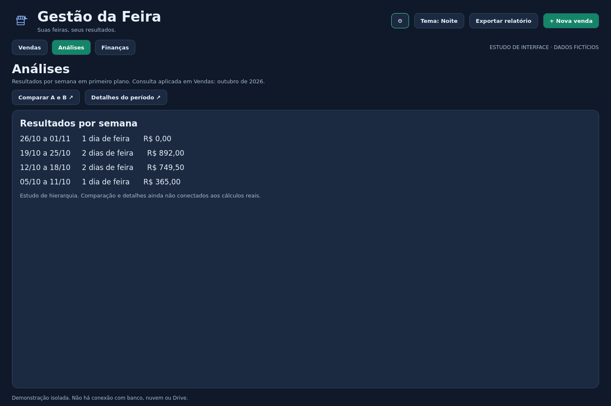

# Material para definir a identidade visual

Esta etapa foi acrescentada a pedido do usuário, **antes da escolha da ferramenta e da implementação da reforma**. As primeiras demos não receberam aprovação visual. Tkinter e PySide6 usam a mesma composição de propósito; a avaliação não precisa escolher um deles agora.

## Como levar o material para outra IA

1. Copie o [briefing completo em TXT](BRIEFING_IDENTIDADE_VISUAL.txt).
2. Envie as três imagens de uma das demos abaixo. As imagens da outra ferramenta são uma segunda referência da mesma composição, não outro layout.
3. Acrescente as referências do aplicativo anterior, principalmente Vendas, comparação e compra parcelada. Elas mostram funções ainda esquemáticas ou ausentes na demo.
4. Peça imagens separadas de cada tela e os detalhes descritos no briefing. Devolva as propostas para avaliarmos e reproduzirmos numa demo antes de integrar ao programa.

Para salvar uma imagem no GitHub, abra o arquivo e use **Raw / Download raw file** ou abra a imagem e use **Salvar imagem como**. Envie os PNGs à outra IA: alguns serviços não conseguem ler imagens apenas pelo link.

Todos os dados mostrados são fictícios. As capturas das demos têm 1.440 × 960 pixels, feitas em Linux; precisam de avaliação no Windows. **São referências funcionais, não exemplos de acabamento aprovado.**

## 1. Vendas — início

**O que mostra:** a parte superior representa os indicadores aprovados, enquanto a parte inferior esboça o histórico. A demo usa rótulos simples para os filtros, não seu formulário completo. A faixa semanal também é uma referência simplificada, não sua reprodução definitiva.

**Função real:** registrar e consultar vendas; filtrar por ano, mês, fechamento e dias da semana; selecionar, editar, excluir e exportar. Os indicadores mostram a seleção aplicada. A semana atual tem um recorte independente, de segunda até hoje.

**O que pedir ao designer:** preservar a parte superior já aprovada no aplicativo real e reconstruir a parte inferior: tabela predominante, colunas proporcionais, filtros legíveis e compactos, ações próximas. Não copiar o alinhamento por espaços dos textos da demo como solução final de tabela.

### Tkinter

### PySide6

## 2. Análises — entender e comparar

**O que mostra:** histórico semanal em destaque, com acesso a Comparar A/B e Detalhes do período. A lista ainda é esquemática e deixa espaço vazio; não é o desenho final de uma tabela. Esses dois botões ainda mostram apenas um aviso na demo.

**Função real:** analisar semanas, comparar dois períodos independentemente e consultar resumo, participação por pagamento, dias da semana e evolução. O resumo e as semanas seguem a seleção aplicada em Vendas; o comparador tem seleção própria.

**O que pedir ao designer:** tela própria sem repetir cartões de Vendas, tabela semanal bem estruturada e detalhamentos claros. Aproveitar o espaço sem esticar painéis vazios. Desenhar também o comparador e o acesso ao resumo, sem outra fileira de abas.

### Tkinter

### PySide6

## 3. Finanças — cobrir despesas e acompanhar compromissos

**O que mostra:** consulta no cabeçalho da área, três cartões principais, três valores secundários em linha e uma lista de lançamentos com ações. Existem acessos a despesas por semana e histórico de taxas. Essa hierarquia inicial não obriga a manter os três cartões ou suas dimensões.

**Função real:** confrontar vendas menos taxas com despesas do período, registrar compras e taxas, consultar parcelas e editar a compra inteira. O saldo não representa necessariamente lucro do negócio. A consulta financeira é independente de Vendas.

**O que pedir ao designer:** reduzir os retângulos desproporcionais, aproximar rótulos e valores, ajustar margens e bordas, preservar o espaço útil da lista. Prever seletores adaptativos de semana/mês/ano/fechamento e indicar claramente data da compra versus data da fatura. Não esconder valores secundários nem os acessos de taxas e fechamento.

### Tkinter

### PySide6

## Referências complementares do aplicativo anterior

Estas imagens já estavam na documentação do projeto, com dados fictícios. São registros anteriores, **não capturas novas da versão 1.7.1**: podem não mostrar recursos recentes, como a faixa semanal. Use o briefing e o [mapa de funções](MAPA_FUNCOES.txt) para completar o conteúdo obrigatório. Não presumir que um recurso ausente no print deixou de existir.

- [Vendas — tema Grafite](../../docs/imagens/vendas-grafite.png): referência dos blocos superiores e histórico; a parte inferior será reconstruída.
- [Análises](../../docs/imagens/analises.png): tipos de resultado e gráficos a preservar, com outra hierarquia.
- [Comparação A/B](../../docs/imagens/comparacao.png): seletores e resultados de dois períodos; detalhe a desenhar além da tela principal de Análises.
- [Finanças](../../docs/imagens/financas.png): conteúdo e acessos anteriores, sem obrigação de repetir sua distribuição.
- [Compra parcelada](../../docs/imagens/compra-parcelada.png): campos e prévia; o briefing registra a regra atual de valor total e edição da compra inteira.

## Depois das propostas

Primeiro revisar função, hierarquia e identidade com o usuário. Depois implementar a referência escolhida em uma demo navegável, avaliar Windows e escalas e concluir a escolha técnica. Uma imagem bonita não valida desempenho, teclado ou preservação de regras.

[Como executar e atualizar as demos no VS Code](GUIA_VSCODE.md) · [Briefing para copiar](BRIEFING_IDENTIDADE_VISUAL.txt) · [Plano atualizado](../../docs/PLANO_REFORMA_DESKTOP.txt)
