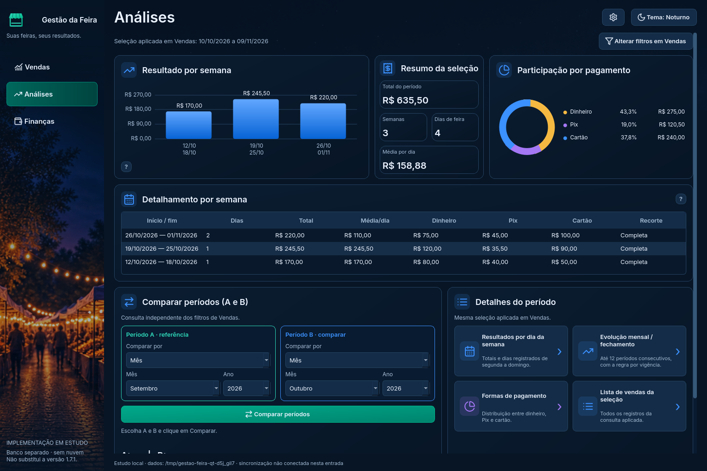

# Análises integrada — Etapa 4

Esta é a segunda entrega funcional em PySide6, na mesma entrada de estudo. A tela usa o banco separado da reforma e os cálculos da versão estável. Finanças será a próxima integração; o executável 1.7.1, o banco pessoal, a sincronização e a PWA continuam preservados.



## Abrir e conferir

Na cópia **Gestao-da-Feira-Estudo**, branch `reforma/estudo-interface`:

```powershell
git pull --ff-only origin reforma/estudo-interface
.\.venv-estudo\Scripts\python.exe -m pip install -r prototipos/reforma/requirements.txt -r requirements.txt
.\.venv-estudo\Scripts\python.exe executar_reforma.py --exemplo --pagina Análises
```

Também é possível abrir normalmente e clicar em Análises. `--pagina` apenas escolhe a tela inicial. Sem `--pasta-estudo`, tudo é temporário e descartado ao fechar. Para conservar os testes, use a pasta separada já criada, conforme o [guia de Vendas](README.md). Não copie seu banco real para esta entrada.

## O que acompanha Vendas

Resultado por semana, resumo, participação e detalhes acompanham **todos os registros da consulta aplicada em Vendas**. A busca na tabela, a página visível e seletores ainda não aplicados não recortam esses dados. Um aviso identifica filtros pendentes.

As semanas vão de segunda a domingo e incluem registros zerados. Semanas nas bordas do período ou com dias da semana selecionados aparecem como “Parcial”. “Completa” indica que os filtros não cortam a semana; não significa sete dias vendidos, nem que a semana atual já terminou. O gráfico mostra até 12 semanas recentes; a tabela preserva todas as semanas da consulta.

Os cálculos vêm de `semanas.agrupar_semanas` e `resumos.calcular_indicadores`. Pagamentos usam os mesmos valores do banco e Decimal; a conversão para centavos ocorre apenas na apresentação dos gráficos existentes.

A tela é criada na primeira visita. Voltar sem mudar os dados não refaz a consulta. Cadastro, edição e exclusão invalidam o resultado; se a tela estiver oculta, ela é atualizada ao retornar. A navegação mantém um único timer e os filtros de Vendas.

## Comparar A e B

A comparação é independente de Vendas e considera todos os dias da semana. Os seletores oferecem **Data, Mês, Fechamento e Intervalo**. Mês/ano ou calendários aparecem conforme a escolha, sem trocar a data ao preencher outros campos.

A é a referência; a diferença é **B − A** e o percentual mede B em relação a A, como em `ProgramFeira.comparacao`. A imagem da proposta visual não substitui essa regra. Quando A tem total zero ou um período não tem registros, a tela informa que falta base para o percentual. Um dia registrado com zero continua contando.

Os dois períodos são validados antes de consultar. Um intervalo invertido mostra aviso e conserva o resultado anterior. Alterar os seletores exige clicar em Comparar. O botão **Ver indicadores lado a lado** mostra total, dias de feira, média e dinheiro/Pix/cartão da última comparação aplicada.

Depois de alterar uma venda, a comparação aplicada é atualizada com os dados novos. Seletores pendentes continuam pendentes: não substituem silenciosamente os períodos que estavam em comparação.

## Detalhes preservados

- **Resultados por dia da semana:** reutiliza a janela aprovada com sete dias, barras proporcionais e quantidades. A média por dia registrado está no tooltip da barra. Ausência e valor zero permanecem distintos.
- **Formas de pagamento:** reutiliza a tabela aprovada com valores e participação.
- **Lista de vendas da seleção:** reutiliza a janela aprovada com todos os registros e colunas, sem limitar pela página nem pela busca. Ordenar a janela não reordena Vendas.
- **Evolução mensal / fechamento:** usa `tendencias.evolucao`, incluindo até 12 períodos consecutivos e o histórico real de fechamento. Intervalos sem registro aparecem como “Sem registros”; feiras zeradas aparecem como registros de valor zero. O total dos períodos exibidos é separado do total de toda a seleção. A ordenação de períodos usa datas, incluindo mudança de ano.

A comparação anterior continua disponível na tela de Vendas, pelo mesmo núcleo. Nenhuma dessas janelas grava dados ou muda a seleção aplicada.

## Validação desta entrega

A suíte da integração tem **32 testes**: 18 de Vendas e 14 novos de Análises. Os cenários incluem equivalência de indicadores/semanas/pagamentos, fechamento por vigência, ano bissexto, dezembro/janeiro, intervalos inválidos, semanas recortadas, registros zerados, períodos vazios, evolução de 12 períodos, filtros pendentes, busca/paginação, atualização da comparação aplicada, novos anos, janela estreita e navegação sem novas consultas/timers.

Resultados finais:

| Ambiente | Integração Qt | Aplicação estável | Protótipos |
| --- | --- | --- | --- |
| Windows Server 2025, Python 3.13.16, SQLite 3.50.4 | 32/32 aprovados | 202/202 aprovados | 31/31 aprovados |
| Linux, Python 3.13.5, SQLite 3.50.4 | 32/32 aprovados | 200 aprovados, 2 ignorados | 31/31 aprovados |

Os dois ignorados no Linux dependem de PowerShell/DPAPI do Windows e passaram na VM Windows. Não houve falha ou erro nas rodadas finais. A captura foi gerada pelo próprio lançador e inspecionada.

Evidência Windows: [execução 40554510830](https://github.com/SilvioCf27/Programa-de-Vendas/actions/runs/40554510830), commit-base `2f3c424e6ed4c87c86bd13c98ff0abbb3902b2ff`:

- [32 testes da integração](resultados/windows-40554510830/INTEGRACAO_QT.json), [202 da aplicação](resultados/windows-40554510830/PRODUCAO.json) e [31 dos protótipos](resultados/windows-40554510830/PROTOTIPOS.json).
- [Origem](resultados/windows-40554510830/ORIGEM.json) e [resolução/restauração da VM](resultados/windows-40554510830/TELA_WINDOWS.json).
- Linux: [integração](resultados/linux-analises/INTEGRACAO_QT.json), [aplicação](resultados/linux-analises/PRODUCAO.json), [protótipos](resultados/linux-analises/PROTOTIPOS.json) e [origem](resultados/linux-analises/ORIGEM.json).

Os testes Qt usam backend `offscreen`. Eles não substituem interação no computador do usuário, DPI real do Windows, alto contraste, leitor de tela completo, uso prolongado ou o futuro teste de empacotamento/atualização. Nenhuma release foi gerada.

## Próxima atividade

Integrar **Finanças**, mantendo a sequência da Etapa 4: consultas, despesas/parcelas, taxas e histórico de fechamento. Configurações e demais mecanismos vêm depois, antes das verificações das Etapas 5 e 6. O [plano original em andamento](../docs/PLANO_REFORMA_DESKTOP.txt), seção 20, continua sendo a referência.
