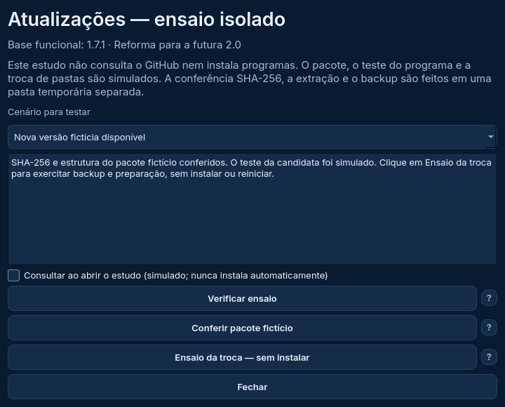
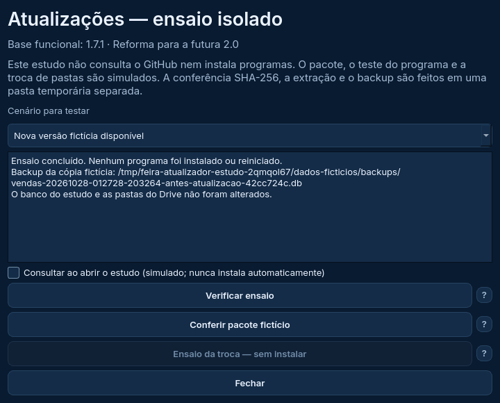

# Atualizações — ensaio isolado da interface Qt

Configurações agora abre o atualizador Qt. **Nesta entrada ele é um ensaio:** não consulta a rede, baixa um programa real, executa PowerShell ou troca sua instalação. A base continua 1.7.1; a indicação fictícia `v2.0.0` não significa que a versão 2.0 foi publicada.



## Como testar

Na cópia de estudo, branch `reforma/estudo-interface`:

```powershell
git pull --ff-only origin reforma/estudo-interface
.\.venv-estudo\Scripts\python.exe executar_reforma.py --pasta-estudo D:\Feira2026\Dados-Estudo-Qt --exemplo
```

1. Abra a engrenagem → **Atualizações — ensaio isolado**.
2. No cenário **Nova versão fictícia disponível**, clique em **Verificar ensaio**. A consulta usa metadados locais para exercitar a regra de publicação estável/completa/mais recente do núcleo.
3. Clique em **Conferir pacote fictício**. O SHA-256 e a extração são reais; a candidata é um arquivo de texto, cujo teste é simulado. Nenhum executável é iniciado.
4. Clique em **Ensaio da troca — sem instalar**. Cancelar preserva a preparação. Confirmar exercita backup e preparação numa cópia temporária, sem trocar pastas ou reiniciar o aplicativo.
5. Confira o resultado e os dados do estudo. Eles devem permanecer iguais, assim como a versão instalada em seu computador.
6. Repita escolhendo **SHA-256 incorreto**, **Candidata reprovada no ensaio**, **Publicação fictícia incompleta** e **Falha ao preparar a troca**. A operação deve ser interrompida com explicação e permitir nova consulta. O cenário **Nenhuma versão mais recente** não habilita preparação.



A janela bloqueia as outras janelas para evitar edições concorrentes. O trabalho roda em segundo plano; enquanto estiver ocupado, não é possível fechá-la ou encerrar pelo botão do programa.

## Consulta automática

A opção **Consultar ao abrir o estudo** fica desligada inicialmente nesta entrada. Se ativar, reabra com a mesma pasta: a consulta fictícia ocorre após aproximadamente 12 segundos. Se uma edição/operação estiver aberta, aguarda 30 segundos para tentar novamente. Abra Atualizações para ver o resultado; ela nunca prepara, instala ou confirma a troca sozinha.

A preferência usa o formato `{"consultar": true/false}` do programa existente, somente na pasta de estudo. Falha ao salvar conserva o valor anterior. O comportamento/padrão do executável 1.7.1 não foi alterado. Sem `--pasta-estudo`, banco e preferências são temporários.

## O que o ensaio verifica

Ele reutiliza `consultar`, `preparar` e `instalar` do atualizador existente, com dependências privadas para metadados/ZIP locais e processos simulados. Não altera os globais do módulo funcional nem depende de analisar arquivos de código-fonte em execução.

A validação de release, versão, SHA-256, estrutura/caminhos ZIP e criação do backup passam pelas funções do núcleo. A execução da candidata e o início do programa auxiliar são simulados. Os relatórios de candidata são fixtures, **não evidências de um executável Windows válido**.

O banco de estudo é copiado para uma pasta temporária separada de um aplicativo também fictício. O núcleo cria o backup dessa cópia. **Não são copiadas configurações de Drive ou sessão**, e o ensaio não envia arquivos ao Drive. O caminho mostrado no resultado pertence ao ensaio temporário; não é um backup para recuperação dos seus dados reais. A pasta é removida ao encerrar ou reiniciar o ensaio.

Os dados/configurações do estudo e a instalação principal permanecem intactos. Se você configurou o backup normal ao fechar o estudo, ele continua sendo uma operação separada do ensaio.

## Validação e pendências

Linux: **107/107 testes Qt**, **200 da aplicação aprovados e dois ignorados por exigirem Windows**, **31/31 dos protótipos**. [Relatórios locais](resultados/linux-atualizacao). **Windows: 107/107 testes Qt, 202/202 da aplicação e 31/31 dos protótipos**, sem falhas, erros ou testes ignorados. [Relatórios da execução 40615267278](resultados/windows-40615267278), base `b963427`. A resolução da VM foi restaurada. A renderização Qt é offscreen; interação manual, DPI e instalação real da nova interface não são comprovados por essa rodada.

Dez cenários novos cobrem caminho confirmado, nenhuma versão nova, publicação incompleta, SHA-256 incorreto, candidata reprovada, cancelamento, falha e retomada, preservação dos arquivos, backup com finanças, preferência, agendamento e bloqueio de operações concorrentes.

A suíte existente também testa o helper original no Windows com troca e recuperação de pastas de teste. Isso não substitui o teste do **pacote PySide6 real**, do reinício/recibo da nova interface e da atualização **1.7.1 → 2.0**, incluindo recuperação em caso de falha. Consulta/download reais, integração com o Drive durante instalação e preservação de sessão/configurações na atualização completa ainda exigem validação nas etapas previstas. DPI, leitor de tela e interação manual também continuam pendentes.

Antes da publicação, a entrada de produção deverá usar o adaptador real e remover os controles/fixtures de ensaio. Não houve essa liberação nesta entrega.

**Próxima atividade:** revisão conjunta da Etapa 4 e rastreamento do inventário para registrar lacunas, inclusive diagnósticos e demais caminhos. A etapa não é considerada concluída apenas porque as telas existem. Depois seguem as verificações de desempenho, equivalência, integração e empacotamento das Etapas 5/6, antes da publicação aprovada da 2.0. A PWA permanece preservada.
