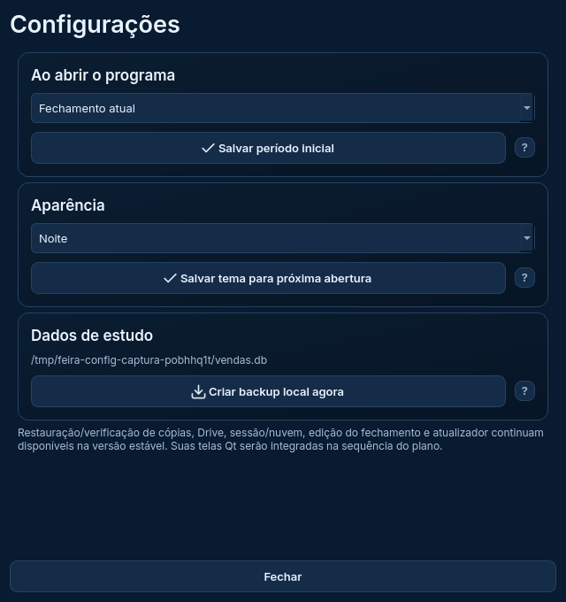

# Configurações — preferências, temas e backup local

Esta é a primeira parte das configurações Qt na Etapa 4. Vendas, Análises e Finanças continuam conectadas ao banco separado de estudo. A versão funcional 1.7.1, o banco pessoal, seus backups/Drive, sincronização e PWA não foram alterados.

A entrega anterior de Finanças foi concluída e enviada ao GitHub, com 56 testes da integração, 202 da aplicação e 31 dos protótipos aprovados no Windows. Não houve arquivo pendente nem perda de trabalho por limite de tokens. As verificações manuais/Windows/DPI e os mecanismos ainda não migrados são pendências planejadas, descritas no plano.



## Abrir e usar

Na cópia **Gestao-da-Feira-Estudo**, branch `reforma/estudo-interface`:

```powershell
git pull --ff-only origin reforma/estudo-interface
.\.venv-estudo\Scripts\python.exe executar_reforma.py --exemplo
```

Clique na engrenagem ou no botão do tema. Sem `--pasta-estudo`, o banco e as preferências são temporários. Para testar a persistência ao fechar e abrir, escolha uma pasta separada, inicialmente vazia:

```powershell
.\.venv-estudo\Scripts\python.exe executar_reforma.py --pasta-estudo D:\Feira2026\Dados-Estudo-Qt --exemplo
```

Reabra com o mesmo comando. Se já estiver usando uma pasta de estudo, continue usando essa pasta. Não aponte para o banco pessoal, não copie suas informações reais e não substitua o executável instalado.

## Preferências sem interromper o trabalho

**Período inicial:** Fechamento atual, Mês atual, Ano atual ou Todas as vendas. Usa as funções existentes de `preferencias.py` e `semanas.py`. O período salvo é usado na próxima abertura; não aplica seletores pendentes nem muda os números ou a seleção da sessão atual. A semana atual continua independente.

**Tema:** Noite, Claro, Grafite, Areia e Aurora. Os identificadores de preferências são os mesmos do programa estável. Salvar vale na próxima abertura, com aviso explícito. A interface não é reconstruída enquanto alguém preenche um formulário ou prepara filtros. Cada preferência tem seu botão e sua gravação independente: não se promete uma transação conjunta entre os dois arquivos.

Falhas ao gravar são apresentadas sem confirmar sucesso. A gravação continua atômica por arquivo, pelo módulo já existente. Esta entrega não modifica os cálculos, lançamentos ou dados financeiros.

## Cinco temas compatíveis

Noite mantém a identidade Noturno aprovada. Grafite preserva o destaque verde `#42D5AD`; Aurora usa `#52057B` nas ações. Areia continua escuro. Claro usa cores adequadas a fundo claro e superfícies sólidas no lugar da fotografia atrás de textos.

As paletas existentes estão em um módulo de dados Qt, com teste de igualdade contra os literais do núcleo. Isso evita importar Tkinter ou depender de um arquivo-fonte não distribuído no futuro executável. Os tokens são aplicados antes de construir os widgets; não há troca parcial de uma tela já em uso. Fontes, ícones e distribuição das informações foram mantidos.

Houve uma correção pontual de tonalidades de ação para que texto/ícone e fundo alcancem pelo menos 4,5:1 nos pares verificados. O teste inclui texto principal/secundário sobre superfície e as duas pontas do gradiente, hover e botão de consulta. Não é uma certificação de todos os contrastes, controles nativos, foco, alto contraste ou leitores de tela.

| Tema | Captura com dados fictícios |
| --- | --- |
| Noite | [Abrir imagem](imagens/tema-escuro.png) |
| Claro | [Abrir imagem](imagens/tema-claro.png) |
| Grafite | [Abrir imagem](imagens/tema-grafite.png) |
| Areia | [Abrir imagem](imagens/tema-areia.png) |
| Aurora | [Abrir imagem](imagens/tema-aurora.png) |

## Backup manual local

**Criar backup local agora** usa `banco.criar_backup`, com a verificação já existente. Inclui vendas e as tabelas financeiras/históricas do banco ativo, sem substituí-lo. A tela mostra o caminho da cópia dentro de `backups` da pasta de estudo.

Esse comando não envia ao Drive, não configura uma conta e não restaura dados. Se a cópia falhar, a tela informa o erro. O teste compara o banco antes/depois, confere integridade SQLite e verifica que a cópia contém vendas, despesas e histórico anual.

## Testes e limites

A integração tem **64 testes**: os 56 anteriores e oito desta parte. Cobrem preservação de filtros pendentes/seleção, leitura da preferência na abertura, falha de gravação, conteúdo do backup e falha de cópia, paridade das paletas, pares de contraste e abertura das três áreas nos cinco temas. Os 15 cenários de tema usam processos separados e conferem contagens e integridade SQLite sem duplicar os exemplos.

Resultados finais, sem falhas ou erros:

| Ambiente | Integração Qt | Aplicação estável | Protótipos |
| --- | --- | --- | --- |
| Windows Server 2025 / Python 3.13.16 / SQLite 3.50.4 | 64/64 aprovados | 202/202 aprovados | 31/31 aprovados |
| Linux / Python 3.13.5 / SQLite 3.50.4 | 64/64 aprovados | 200 aprovados, 2 ignorados | 31/31 aprovados |

Os dois ignorados no Linux dependem de PowerShell/DPAPI; passaram no Windows.

Evidência Windows: [execução 40583007189](https://github.com/SilvioCf27/Programa-de-Vendas/actions/runs/40583007189), commit-base `aa4f7850c6597200d4e588ef9a001e5aa0a4b69f`:

- [Integração](resultados/windows-40583007189/INTEGRACAO_QT.json), [aplicação](resultados/windows-40583007189/PRODUCAO.json), [protótipos](resultados/windows-40583007189/PROTOTIPOS.json), [origem](resultados/windows-40583007189/ORIGEM.json) e [resolução/restauração da VM](resultados/windows-40583007189/TELA_WINDOWS.json).
- Linux: [integração](resultados/linux-configuracoes/INTEGRACAO_QT.json), [aplicação](resultados/linux-configuracoes/PRODUCAO.json), [protótipos](resultados/linux-configuracoes/PROTOTIPOS.json) e [origem](resultados/linux-configuracoes/ORIGEM.json).
- [Pares de contraste medidos](resultados/linux-configuracoes/CONTRASTE.json).

As capturas de configurações e dos cinco temas foram inspecionadas. Qt `offscreen` não substitui inspeção interativa no seu Windows, DPI real, leitor de tela completo, uso prolongado ou validação do pacote e do atualizador. Nenhum executável novo foi lançado.

## O que vem a seguir

Restaurar/verificar cópias e integrar o Drive; depois, sessão/sincronização, edição do fechamento por vigência e atualizador. Essas funções continuam no aplicativo estável e não aparecem como falsamente prontas nesta entrada Qt. A Etapa 4 ainda está em andamento. O [plano original](../docs/PLANO_REFORMA_DESKTOP.txt), seção 22, mantém a cronologia.
