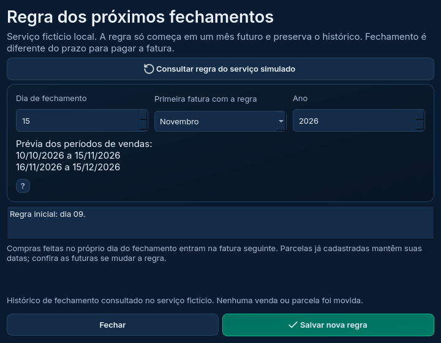
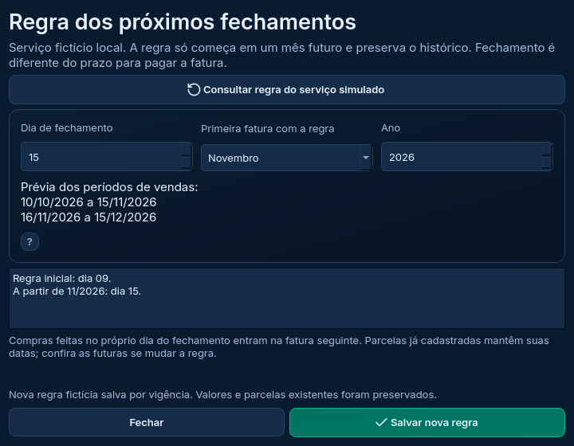

# Fechamento por vigência — estudo Qt

Configurações e Finanças agora abrem a mesma janela para consultar e editar uma regra futura. Ela reutiliza o núcleo do programa, mantendo o histórico e as parcelas já cadastradas. A regra é salva **somente no serviço fictício local do estudo**. Sua conta real, a versão 1.7.1, o banco pessoal e a PWA não foram alterados.



## Como testar

Na cópia de estudo, branch `reforma/estudo-interface`:

```powershell
git pull --ff-only origin reforma/estudo-interface
.\.venv-estudo\Scripts\python.exe executar_reforma.py --pasta-estudo D:\Feira2026\Dados-Estudo-Qt --exemplo
```

1. Em Configurações → Sessão e sincronização, conecte a **conta fictícia**, como na entrega anterior. Não há acesso à sua conta real. Não é necessário transferir vendas para editar o fechamento do estudo.
2. Abra **Regra de fechamento por vigência**, nas configurações, ou **Regra de fechamento**, em Finanças. Sem sessão, o histórico continua disponível somente para leitura.
3. Clique em **Consultar regra do serviço simulado** para habilitar a edição. A consulta confirma a versão e o histórico; campos escolhidos não são substituídos silenciosamente.
4. Escolha dia, mês da primeira fatura e ano. Confira os dois períodos da prévia antes de salvar.
5. **Salvar nova regra** pede confirmação. Confira a mensagem e o histórico atualizado. Feche e reabra o estudo com a mesma pasta para verificar a persistência.

O exemplo da imagem usa dia **15 a partir da fatura de novembro/2026**: o período aberto de outubro passa a ser **10/10 a 15/11**, e o seguinte fica **16/11 a 15/12**. O período já encerrado de setembro continua **10/09 a 09/10**. Esses são exemplos fictícios; sua regra pessoal continua no dia 09.



## O que a mudança faz

O mês indicado é o da **primeira fatura com o novo dia de fechamento**, não seu prazo para pagamento. Só é possível escolher um mês futuro. Uma vigência não pode vir antes da regra mais recente; a última regra futura pode ser revisada sem duplicar a entrada do histórico.

Dias que não existem no mês usam seu último dia. Por exemplo, uma regra de dia 31 fecha em 28 ou 29 de fevereiro. Uma compra feita no próprio dia do fechamento vai para a fatura seguinte, conforme o núcleo existente.

**Valores e datas de parcelas já cadastradas permanecem iguais.** A regra muda os períodos consultados e o cálculo das próximas compras cadastradas. Ela não reescreve as parcelas existentes; confira as futuras se mudar o dia. A mudança pode encurtar ou alongar o período ainda aberto.

## Proteções e recuperação

A gravação compara a versão consultada com a do serviço. Se outra alteração ocorreu, ela é recusada: consulte novamente, confira a prévia e confirme outra vez. Cancelar não grava uma regra. Ano/dia incompletos, mês atual/passado e vigência anterior à mais recente são recusados.

O núcleo preserva uma cópia antes de atualizar o histórico SQLite e verifica o vínculo de conta/projeto. Se o serviço confirmar a regra e a gravação local falhar, o programa informa que a cópia local ainda não foi atualizada. Resolva o problema de armazenamento e **consulte novamente** para reconciliar o histórico; não presuma que o serviço desfez a mudança.

Falhas definitivas podem pausar a sincronização. Depois de corrigir o problema e consultar a regra, use **Sincronizar agora** para conferir os registros e retomar as consultas, se a opção automática estiver ativa.

Receber uma regra por sincronização atualiza as áreas do programa sem aplicar seletores pendentes. A mensagem identifica a regra recebida e a cópia anterior preservada. Ler/salvar usa trabalhadores Qt e bloqueia edições/fechamento até a operação terminar.

## Validação e limites

Linux: **97/97 testes da integração**, **200 da aplicação aprovados e dois ignorados por exigirem Windows**, **31/31 dos protótipos**. [Relatórios locais](resultados/linux-fechamento). **Windows: 97/97 da integração, 202/202 da aplicação e 31/31 dos protótipos**, sem falhas, erros ou testes ignorados. [Relatórios da execução 40608994527](resultados/windows-40608994527), base `8f2dc89`. A resolução da VM foi restaurada. A renderização Qt é offscreen; não representa uma conferência manual de DPI ou interação no Windows.

Os novos cenários cobrem prévia e transição, fevereiro bissexto, compra no fechamento, histórico/parcelas preservados, confirmação, entrada incompleta, versão concorrente, revisão de regra futura, falha local após confirmação, indisponibilidade, persistência e recebimento por sincronização.

Todos usam dados fictícios, sem rede ou conta real. Isso não comprova o Supabase real, interação manual, DPI, leitor de tela, instalador ou atualização. Não houve alteração dos módulos funcionais ou scripts SQL de produção, nem publicação de um novo executável.

Continuidade entregue: [atualizador Qt em ensaio isolado](ATUALIZACOES.md). **Próxima atividade:** revisão conjunta da Etapa 4 e conferência do inventário. Depois seguem as Etapas 5 e 6 do plano, incluindo a validação real e o ensaio de atualização 1.7.1 → 2.0 antes da publicação.
