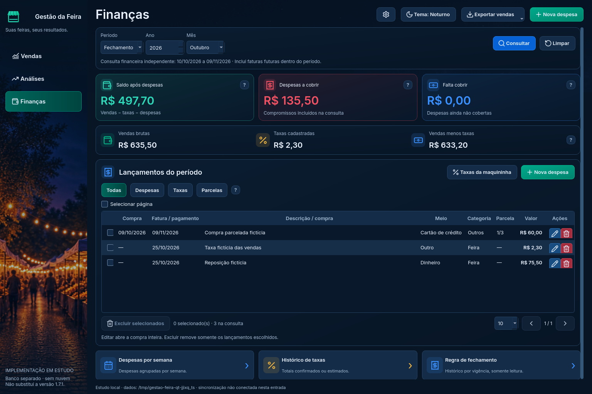
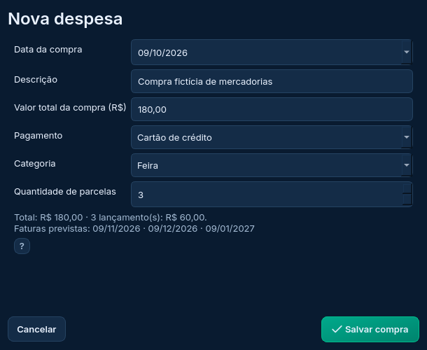
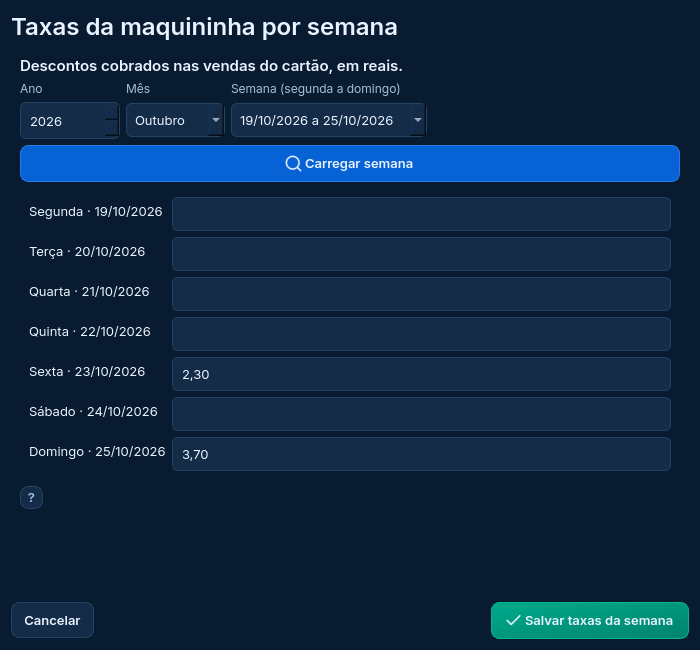

# Finanças integrada — Etapa 4

A terceira tela principal agora usa o núcleo financeiro do programa, na entrada PySide6 de estudo. A versão 1.7.1, seus dados pessoais, a sincronização, o Drive e a PWA continuam preservados. Não é uma nova release.



## Abrir no VS Code

Na cópia **Gestao-da-Feira-Estudo**, branch `reforma/estudo-interface`:

```powershell
git pull --ff-only origin reforma/estudo-interface
.\.venv-estudo\Scripts\python.exe -m pip install -r prototipos/reforma/requirements.txt -r requirements.txt
.\.venv-estudo\Scripts\python.exe executar_reforma.py --exemplo --pagina Finanças
```

Sem `--pasta-estudo`, o banco é temporário e descartado ao fechar. Para conservar os testes, use a pasta separada já criada, como no [guia da entrada Qt](README.md). Não copie o banco pessoal para esta implementação.

A opção `--exemplo` cria vendas quando a lista de vendas está vazia. Os exemplos financeiros só são incluídos nessa criação se ainda não houver lançamentos **nem** totais históricos: uma reposição em dinheiro, uma compra fictícia em três parcelas e uma taxa das vendas. Reabrir não duplica esses registros; apagar as vendas e pedir exemplos novamente também não duplica finanças. Uma pasta de estudo já preenchida continua com os seus testes.

## Consulta e leitura do saldo

Semana, Mês, Fechamento e Ano têm seletores adaptativos. Semana mostra intervalos de segunda a domingo, inclusive quando atravessam meses/anos. Fechamento usa o mês inicial e a regra vigente em cada época. O período financeiro é independente dos filtros de Vendas.

Alterar os campos não troca os números até **Consultar**. Salvar uma despesa também não aplica por engano os seletores pendentes. Os recortes Todas/Despesas/Taxas/Parcelas e a paginação alteram somente a lista; os totais consideram a consulta financeira completa.

Saldo, despesas, falta cobrir, vendas brutas, taxas e vendas menos taxas vêm de `financeiro.resumir`, com os mesmos dados do SQLite. Faturas futuras dentro do período entram nos compromissos. Saldo não representa necessariamente lucro: considera apenas o que foi cadastrado. Taxa ausente não significa isenção.

Um total histórico anual só é descontado quando sua cobertura inteira cabe na consulta. Não há rateio entre meses/dias. Se a consulta corta essa cobertura, aparece o aviso de **saldo provisório**; valores estimados também ficam identificados como não confirmados.

O botão superior **Exportar vendas** continua exportando a consulta aplicada em Vendas. Não foi criada exportação de despesas nesta etapa.

## Despesas e compras parceladas

O formulário recebe o **total da compra**, meio de pagamento, categoria e quantidade de parcelas. Uma prévia mostra a soma, os valores distribuídos e as faturas/pagamentos. Os centavos são distribuídos pelo núcleo para que a soma seja exata; não se acrescentam juros automaticamente.

No cartão de crédito, informe a **data da compra**. Na regra inicial, uma compra de 09/10/2026 entra na primeira fatura de 09/11/2026. Em três parcelas, seguem 09/12/2026 e 09/01/2027. Isso usa `financeiro.primeira_fatura` e o histórico de fechamento, sem outra regra criada pela interface.

Editar qualquer parcela abre o total e o histórico da compra inteira. Salvar exige confirmação quando há parcelamento e atualiza inclusive parcelas anteriores. Reduzir a quantidade informa a remoção das últimas parcelas. Uma compra alterada desde a abertura do formulário ou com histórico incompleto é recusada pelo núcleo.

Registros antigos sem a data original mantêm a primeira fatura existente. Para converter, escolha **Informar data original da compra** e selecione essa data; a interface não presume que a primeira fatura antiga era a compra. Os campos de data não são reiniciados ao preencher valor, descrição, pagamento ou categoria. Datas/anos incompletos não reutilizam silenciosamente uma consulta anterior.

Excluir remove somente os lançamentos selecionados. Há confirmação, backup verificado e uma transação para todo o lote. As outras parcelas são preservadas. Excluir parte de uma compra pode deixar seu histórico incompleto e impedir sua edição, conforme a proteção já existente; a confirmação informa esse efeito.



## Taxas da maquininha

São **descontos das vendas no cartão**, em reais por data de venda; não são despesas do cartão usado para comprar mercadorias.

O formulário carrega a semana da referência e permite preencher sexta, domingo ou qualquer dia. Para trocar a semana, altere os seletores e clique em **Carregar semana**. Os campos continuam vinculados às datas exibidas até o carregamento; salvar com outra semana ainda pendente é recusado. Descartar valores não salvos exige confirmação.

Campo vazio mantém uma taxa existente. Zero não apaga uma taxa já cadastrada; a remoção é feita em Excluir. Datas cobertas por um total histórico anual não têm campo editável. O núcleo verifica novamente a cobertura ao salvar e impede contabilizar o mesmo desconto duas vezes.

A primeira passagem dos testes encontrou um problema no seletor Qt: a procura da semana por `QVariant` não comparava `datetime.date` por valor e acabava na primeira opção. A seleção foi corrigida para comparar as datas em Python; o teste verifica explicitamente a semana correta de sexta/domingo.



## Totais históricos e despesas por semana

**Histórico de taxas** mostra todos os anos, independente da consulta financeira. Permite criar, editar e excluir totais com cobertura, natureza Confirmada/Estimada e origem/observação. Ao atualizar, informe o total acumulado, não apenas a diferença. A edição protege o ano; um novo cadastro não sobrescreve um ano existente sem abrir a edição.

O histórico e as taxas por data não podem cobrir o mesmo desconto. As operações reutilizam `salvar_taxa_anual` e `salvar_taxas_semana`, com as proteções atuais e backup anterior à alteração.

**Despesas por semana** reutiliza a janela visual aprovada. Soma todas as despesas da consulta aplicada, inclusive as de outras páginas; ignora taxas e recortes da lista. Crédito é agrupado pela data da fatura, e outros meios pela data de pagamento. As bordas podem estar parciais.

**Regra de fechamento** mostra o histórico por vigência em modo de leitura. As consultas e parcelas já o respeitam. A edição virá com configurações/nuvem na sequência do plano; não foi criada uma conta fictícia para contornar o vínculo e as proteções de `fechamento.guardar`.

## Verificação desta entrega

A suíte agora tem **56 testes**: os 32 anteriores e 24 de Finanças. Cobrem equivalência do resumo, faturas futuras, quatro tipos de período, vigência, datas que atravessam anos, compra no dia 09, persistência da data, edição pela quarta parcela, legado, confirmação/cancelamento, compra alterada/incompleta, exclusão em lote atômica, falha de backup, taxas sexta/domingo, troca de semana, cobertura anual, estimativa, ausência de rateio, paginação, detalhes semanais, histórico, navegação, janela estreita, ano incompleto e reabertura dos exemplos sem duplicar finanças.

Resultados finais, sem falhas ou erros:

| Ambiente | Integração Qt | Aplicação estável | Protótipos |
| --- | --- | --- | --- |
| Windows Server 2025 / Python 3.13.16 / SQLite 3.50.4 | 56/56 aprovados | 202/202 aprovados | 31/31 aprovados |
| Linux / Python 3.13.5 / SQLite 3.50.4 | 56/56 aprovados | 200 aprovados, 2 ignorados | 31/31 aprovados |

Os dois ignorados no Linux dependem de PowerShell/DPAPI e passaram no Windows. Todas as suítes usam diretórios temporários, sem login ou banco pessoal.

Evidência Windows: [execução 40561114351](https://github.com/SilvioCf27/Programa-de-Vendas/actions/runs/40561114351), commit-base `dc2555a1e3e8ffd85c7e548998b85394a7a2e9f8`:

- [Integração](resultados/windows-40561114351/INTEGRACAO_QT.json), [aplicação estável](resultados/windows-40561114351/PRODUCAO.json), [protótipos](resultados/windows-40561114351/PROTOTIPOS.json), [origem](resultados/windows-40561114351/ORIGEM.json) e [restauração da resolução da VM](resultados/windows-40561114351/TELA_WINDOWS.json).
- Linux: [integração](resultados/linux-financas/INTEGRACAO_QT.json), [aplicação](resultados/linux-financas/PRODUCAO.json) e [protótipos](resultados/linux-financas/PROTOTIPOS.json).

As capturas da tela e dos formulários foram inspecionadas. A reabertura foi testada três vezes, inclusive após apagar somente as vendas fictícias: os cinco lançamentos financeiros não foram duplicados e a integridade SQLite permaneceu aprovada.

Os testes Qt usam backend `offscreen`. A inspeção interativa no seu Windows, DPI real, leitor de tela, uso prolongado e pacote/atualizador ainda pertencem às verificações seguintes; não estão declarados concluídos por esses testes.

## Próximo item do plano

Configurações e demais mecanismos da Etapa 4: preferências/temas, backups/restauração/Drive, sessão e sincronização, atualização e edição da regra de fechamento por vigência. A revisão conjunta e as Etapas 5/6 vêm depois, antes de substituir a entrada estável ou publicar executável novo. O [plano original em andamento](../docs/PLANO_REFORMA_DESKTOP.txt), seção 21, continua sendo a referência.
