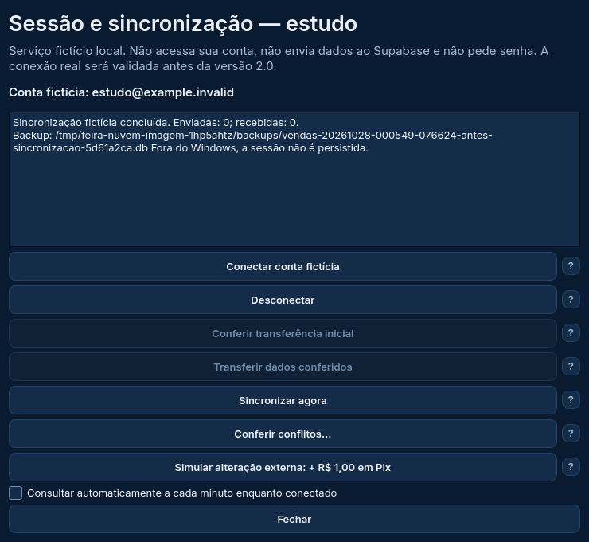
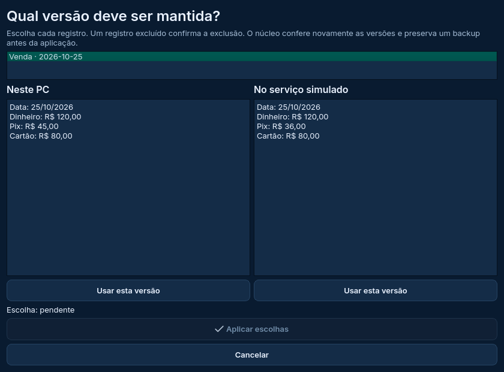

# Sessão e sincronização Qt — serviço fictício local

Esta parte da Etapa 4 liga a interface PySide6 aos mecanismos de sessão, transferência e sincronização já usados pelo programa. **O transporte é simulado localmente.** Não é uma conexão ao Supabase, ao PWA ou à sua conta pessoal. Os registros fictícios não são enviados ao serviço real.

A aplicação funcional continua na versão 1.7.1. O destino da reforma será a **2.0**, após completar o plano, validar a integração real e testar empacotamento e atualização. Nada nesta entrega substitui seu executável, banco pessoal, sessão ou configurações de produção.



## Como conferir

Na cópia de estudo, branch `reforma/estudo-interface`:

```powershell
git pull --ff-only origin reforma/estudo-interface
.\.venv-estudo\Scripts\python.exe executar_reforma.py --pasta-estudo D:\Feira2026\Dados-Estudo-Qt --exemplo
```

Use uma pasta separada, como nas entregas anteriores. Sem `--pasta-estudo`, os arquivos são temporários e desaparecem ao fechar. Não copie o banco pessoal nem arquivos de sessão/configuração da versão em uso.

1. Abra a engrenagem e **Sessão e sincronização — serviço simulado**.
2. **Conectar conta fictícia** usa `estudo@example.invalid`. Não informe sua senha: não há campo para ela. Conectar não transfere registros.
3. **Conferir transferência inicial** gera backup e relatório com as contagens. Confira os dados fictícios.
4. **Transferir dados conferidos** pede confirmação e revalida o banco. Se algum dado mudou desde a conferência, será necessário conferir novamente.
5. **Sincronizar agora** estabelece o vínculo dos registros e permite as consultas automáticas.
6. **Simular alteração externa** acrescenta R$ 1,00 ao Pix da venda fictícia mais recente no arquivo do serviço simulado. Feche tanto a janela da nuvem quanto as configurações; a consulta automática aplica a mudança quando a interface fica livre. Ou use Sincronizar agora.
7. Edite uma venda pelo estudo para conferir o sentido contrário. As alterações locais agendam envio após dois segundos, se a opção automática estiver ativa. Após uma consulta concluída, o intervalo normal é um minuto.
8. **Desconectar** remove a sessão salva do estudo; preserva dados, vínculo, cópias e o arquivo do serviço simulado. Reconectar não deve exigir outra migração após o vínculo inicial.

No Windows, a sessão renovável **fictícia** é protegida pelo DPAPI na pasta do estudo. Ao reabrir, ela é recuperada e renovada antes de consultar. Fora do Windows, a sessão fica apenas na memória; isso aparece no resultado. A proteção DPAPI não é testada por uma simulação no Linux: a rodada nativa do Windows verifica o arquivo protegido.

## Conferir conflitos



Depois de vincular, desligue a opção automática. Edite uma venda pelo estudo e use a simulação externa sobre a mesma venda, alterando também o Pix. Sincronizar deve pausar com conflito, preservando as versões.

Clique em **Conferir conflitos** e depois em **Revisar escolhas dos conflitos**. A janela mostra PC e serviço simulado lado a lado. Escolha uma versão para cada registro e confirme a aplicação. Cancelar não substitui valores. Escolher uma versão excluída confirma a exclusão. Cadastros independentes na mesma data/ano exigem revisão dos cadastros, sem sobrescrita nessa tela.

O núcleo verifica novamente as versões antes de aplicar. Se elas mudaram, a revisão é descartada e precisa ser refeita. Não se escolhe automaticamente pelo horário do dispositivo.

## O que foi reutilizado

- `ClienteNuvem`: autenticação e renovação de sessão, com `_post` atendido exclusivamente pelo serviço fictício, sem encaminhamento HTTP.
- `sessao_windows`: guarda somente a credencial renovável com DPAPI; não grava senha nem token de acesso.
- `migracao_nuvem`: backup, conferência, relatório e transferência inicial revalidada.
- `sincronizacao`: comparação por registro, recibos retomáveis, backups e resolução explícita de conflitos.
- `automacao_nuvem.Agendador`: intervalos, espera progressiva após falha temporária e pausa após falha definitiva; o relógio foi adaptado a QTimer.

Consulta e gravação rodam fora da thread gráfica. A consulta automática aguarda formulários/configurações; se uma edição abrir durante a consulta, a aplicação é adiada. Gravações bloqueiam edições e fechamento até concluir. Receber alterações preserva filtros pendentes e atualiza a área visível sem disparar um envio artificial. Consultas sem mudanças não criam outro backup.

Restaurar uma cópia desativa a automação de forma persistente antes de substituir o banco. Se essa preferência não puder ser salva, a restauração é cancelada. Ao reabrir, confira os dados e sincronize manualmente antes de reativar a opção automática. Isso evita desfazer silenciosamente a recuperação.

Se o arquivo do serviço fictício desaparecer depois do vínculo, a sincronização é interrompida; a ausência não é interpretada como exclusão de todos os registros.

O serviço fictício guarda registros e recibos em `servico-nuvem-estudo.json`, dentro da pasta isolada. Não é backup SQLite nem sincronização com outro dispositivo. Se o Drive estiver configurado, seu cliente poderá enviar as cópias SQLite fictícias, como explicado na entrega anterior; essa é uma operação separada.

## Validação e limites

Linux: **88/88 testes da integração**, **200 da aplicação aprovados e dois ignorados por exigirem Windows**, **31/31 dos protótipos**. [Relatórios locais](resultados/linux-nuvem). **Windows: 88/88 da integração, 202/202 da aplicação e 31/31 dos protótipos**, sem falhas, erros ou testes ignorados. [Relatórios da execução 40607047474](resultados/windows-40607047474), base `c318963`. O DPAPI foi exercitado nativamente no Windows com sessão fictícia; a resolução da VM foi restaurada. A renderização Qt usa offscreen e não comprova interação manual ou DPI real.

Os cenários incluem transferência, duas direções, finanças/parcelas, filtros pendentes, consultas sem mudança, falha temporária, resposta perdida, conflitos, revisão desatualizada, sessão expirada, pausa persistente após restauração, serviço fictício ausente, falha de renderização sem cancelar a próxima consulta e fechamento durante trabalho.

A validação do simulador **não comprova RLS, permissões, autenticação ou concorrência do Supabase real**. Também não substitui testes com projeto separado e dois dispositivos, interação manual, DPI, leitor de tela, instalador ou atualização. A conexão real permanece bloqueada nesta entrada de estudo e será validada antes da publicação da 2.0. A entrada de produção deverá usar o cliente real e remover os controles de simulação; essa liberação ainda não foi feita.

**Próxima atividade:** edição do fechamento por vigência; depois, atualizador. A revisão conjunta e as Etapas 5 e 6 continuam no plano original.
