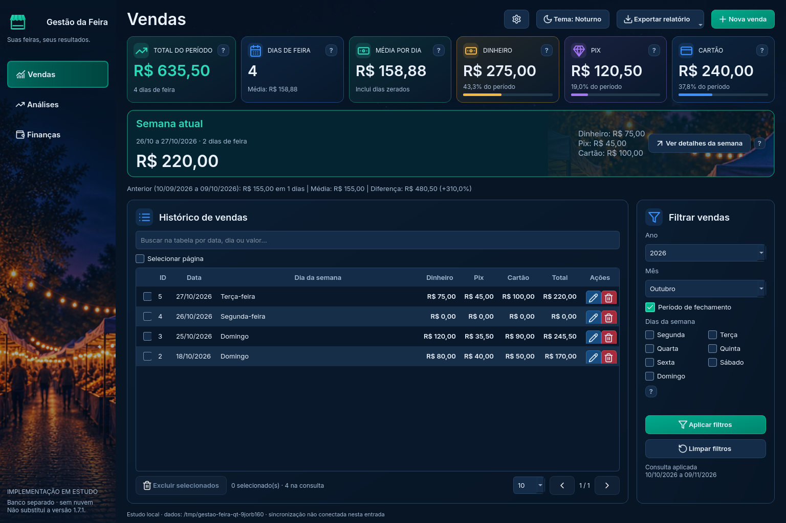

# Reforma desktop — Vendas, Análises e Finanças em PySide6

**Entrega atual:** [entrada gráfica de validação online](VALIDACAO_ONLINE.md), seção 32 do plano. Login real em projeto separado, pasta de execução própria e envio manual por confirmação. A instalação 1.7.1 e o estudo simulado não foram substituídos.

A escolha do PySide6 foi aprovada pelo usuário em 27/10/2026, após a comparação técnica. A primeira entrega iniciou **navegação e Vendas**, primeiro item da Etapa 4 do [plano](../docs/PLANO_REFORMA_DESKTOP.txt), seção 19. Não é uma nova release nem substitui o executável 1.7.1.



## O que já funciona nesta entrada

- Cadastro, edição por ID e cancelamento, com mensagens no formulário. Data repetida é recusada e permite corrigir/continuar sem bloquear a próxima gravação.
- Ano, mês, fechamento por vigência e dias da semana. Não é necessário escolher outro “tipo” para os seletores funcionarem. Alterações ficam pendentes até Aplicar.
- Indicadores e comparação anterior calculados pelos módulos existentes, incluindo registros zerados. A semana atual vai de segunda até hoje e independe do filtro; seus detalhes abrem em janela própria. A virada do dia é conferida a cada minuto.
- Histórico paginado, ordenação numérica/cronológica, seleção da página e exclusão individual/em lote confirmada. O lote é transacional; qualquer registro divergente impede excluir o conjunto. O backup local é verificado antes de alterações; sua falha impede gravar/excluir.
- CSV e Excel pela consulta aplicada completa. Paginação e busca na tabela não reduzem a exportação nem os indicadores. O campo de busca explica esse alcance.
- Navegação conserva a tela de Vendas e um único timer. Não há menu Exportar duplicado.

Os módulos `database/banco.py`, `database/armazenamento.py`, `fechamento.py`, `resumos.py`, `semanas.py`, `preferencias.py` e `exportacao.py` são reutilizados. Não foram alterados. O adaptador `vendas.py` reúne somente a consulta e as ações desta interface; não importa `ProgramFeira.main`, não cria janela Tkinter e não usa os cálculos fictícios da demo.

Os recursos e componentes visuais aprovados continuam compartilhados com `prototipos/reforma`. Essa dependência está explícita e será organizada ao consolidar a interface; não se instanciam a aplicação ou o estado fictício da demo. A captura mostra dados fictícios criados pelo próprio lançador.

## Abrir no VS Code, na cópia de estudo

No terminal PowerShell da pasta **Gestao-da-Feira-Estudo**, já na branch `reforma/estudo-interface`:

```powershell
git pull --ff-only origin reforma/estudo-interface
.\.venv-estudo\Scripts\python.exe -m pip install -r prototipos/reforma/requirements.txt -r requirements.txt
.\.venv-estudo\Scripts\python.exe executar_reforma.py --exemplo
```

Isso abre a implementação funcional Qt em um banco temporário com exemplos. Pode cadastrar, editar, excluir e exportar. **Os testes são descartados ao fechar**, e os seus dados pessoais não são abertos.

Para conservar somente os testes entre execuções, escolha uma pasta nova e separada:

```powershell
.\.venv-estudo\Scripts\python.exe executar_reforma.py --pasta-estudo D:\Feira2026\Dados-Estudo-Qt --exemplo
```

Nas próximas vezes, use o mesmo comando. `--exemplo` só inclui os exemplos se o banco estiver vazio; omita essa opção se quiser começar sem registros. Não a use após apagar todos os testes se não quiser repovoar o banco. A pasta conserva também os backups locais das alterações.

**Não aponte para `%LOCALAPPDATA%\ProgramFeira` nem copie seu banco real.** O lançador recusa a pasta pessoal e pastas ocupadas sem o marcador de estudo. O marcador identifica a pasta criada pelo lançador, não é uma proteção contra alguém que deliberadamente o falsifique. A variável de dados é definida apenas no processo da entrada Qt, antes de importar o banco; o programa instalado continua usando seu caminho normal.

O lançador original `executar.py`, o executável instalado e `noturno_demo.py` continuam funcionando como antes. As demos continuam sendo somente visuais; o novo comando acima é a entrada funcional desta etapa.

## Estado atual e limites

As três telas já estão integradas no banco de estudo. Consultas e formulários financeiros, edição do fechamento e mecanismos de configuração estão disponíveis. A [revisão atual](REVISAO_ETAPA4.md) identifica as lacunas de equivalência e a distinção entre operações locais e simulações.

Editor da preferência de abertura, cinco temas e criação de backup local já estão integrados. Restauração/verificação e Drive manual também estão integrados: veja [Recuperação e Drive](RECUPERACAO.md). Sessão e sincronização Qt usam agora um serviço fictício local: veja [Nuvem em estudo](NUVEM.md). A [edição do fechamento por vigência](FECHAMENTO.md) também está integrada ao serviço fictício. O [atualizador Qt está disponível em ensaio isolado](ATUALIZACOES.md), sem instalar programas. A revisão percorreu o inventário; as seis lacunas foram corrigidas. A regressão e a revisão repetida passaram no Linux e no Windows. A [Etapa 5](DESEMPENHO.md) mediu e otimizou o conjunto; a próxima atividade é a Etapa 6. Esta entrada não sincroniza com PWA/Supabase real. Se você configurar o Drive, o cliente do Google poderá enviar as cópias fictícias para a nuvem. A preferência de abertura existente já é lida quando presente na pasta de estudo. Noite conserva a identidade Noturno; as outras paletas são opções para a próxima abertura.

A aprovação visual não foi reaberta. A integração ainda não representa equivalência completa, estabilidade de uma release, validação manual Windows/DPI/leitor de tela ou teste do atualizador.

## Verificações

Os testes da primeira fatia verificam gravação e backup, falhas, atomicidade do lote, filtros e regras de fechamento, dados zerados, semana, virada do dia, ordenação, seleção/paginação, exportação completa, formulários, janela de 1.000 × 700 sem corte lateral e navegação sem timers duplicados. Cada teste usa diretório temporário; não há conta configurada.

```powershell
.\.venv-estudo\Scripts\python.exe reforma_desktop/validar.py --saida resultado-vendas-qt.json
```

O workflow `reforma-vendas-windows.yml` repete essa suíte e as suítes existentes da aplicação e dos protótipos no Windows, sem gerar release, executável público ou acessar dados pessoais. Os testes Qt usam o backend `offscreen`; confirmam comportamento dos controles e operações no Windows, mas não substituem sua inspeção interativa, DPI real ou leitor de tela. A resolução Full HD da VM é preparada/restaurada para os testes Tk existentes. Os resultados conferidos estão abaixo.

Para sua revisão manual: cadastre uma venda fictícia; tente repetir a data e depois corrija; edite e cancele uma edição; aplique mês/ano/fechamento; deixe um filtro pendente e confira que o resumo não muda; selecione/exclua registros; exporte com mais de uma página; visite Análises/Finanças e retorne para Vendas. São verificações da entrada isolada, não do seu banco real.

Análises, Finanças e os mecanismos do estudo foram entregues na continuidade. A [revisão atual](REVISAO_ETAPA4.md) registra as correções e os limites da Etapa 4. A entrada estável só será substituída após as verificações previstas nas Etapas 5 e 6.


### Histórico — resultado da primeira entrega de Vendas

| Ambiente | Vendas Qt | Aplicação estável | Protótipos |
| --- | --- | --- | --- |
| Windows Server 2025 / Python 3.13.16 / SQLite 3.50.4 | 18/18 aprovados | 202/202 aprovados | 31/31 aprovados |
| Linux / Python 3.13.5 / SQLite 3.50.4 | 18/18 aprovados | 200 aprovados, 2 ignorados | 31/31 aprovados |

No Linux, os dois ignorados dependem de PowerShell/DPAPI nativos do Windows; passaram na VM Windows. Nenhuma falha ou erro permanece na rodada final. O SQLite local compatível foi selecionado somente para os processos de teste, sem alterar a proteção dos backups.

Evidência final: [execução Windows 40551429100](https://github.com/SilvioCf27/Programa-de-Vendas/actions/runs/40551429100), commit-base `86478827bb500d0a995f15c63d0b24b2ea9b8e00`:

- [Vendas Qt](resultados/windows-40551429100/VENDAS_QT.json), [aplicação estável](resultados/windows-40551429100/PRODUCAO.json) e [protótipos](resultados/windows-40551429100/PROTOTIPOS.json).
- [Origem](resultados/windows-40551429100/ORIGEM.json) e [resolução/restauração da VM](resultados/windows-40551429100/TELA_WINDOWS.json).
- [Vendas Qt no Linux](resultados/linux/VENDAS_QT.json), [regressão da aplicação](resultados/linux/PRODUCAO.json) e [protótipos](resultados/linux/PROTOTIPOS.json).

A primeira execução Windows (`40550497209`) aprovou Vendas Qt e a aplicação, mas falhou na área visível da tabela do protótipo Tk antigo, com o monitor virtual em 1.024 × 768. A automação passou a preparar/restaurar Full HD, como na comparação anterior; o código e a exigência de linhas visíveis do protótipo não foram alterados. A repetição `40551010313` passou nos 17 testes Qt então existentes e nas duas suítes. A rodada final acrescentou o teste de janela estreita e passou nos 18. Os JSONs dessas passagens foram preservados como histórico, sem misturar seus resultados com os finais.

Também foi verificada a abertura gráfica por `executar_reforma.py` e sua reabertura duas vezes na mesma pasta temporária de estudo: cinco exemplos, sem duplicação, com integridade SQLite aprovada. A captura desta página foi inspecionada. Permanecem pendentes a inspeção interativa no seu Windows, DPI real, acessibilidade completa e pacote/atualizador da aplicação reformada; não foi publicado executável novo.
