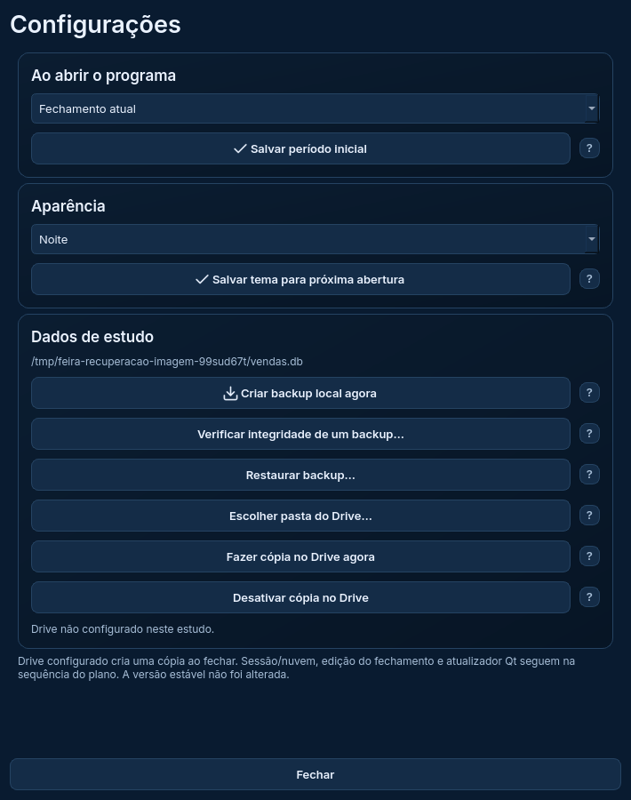

# Recuperação e Drive — banco de estudo

A engrenagem agora reúne a verificação de backups, restauração e cópia manual e ao fechar para a pasta do Drive, além das preferências já entregues. A versão 1.7.1, seus dados, seus backups reais e a PWA continuam preservados.

## Testar no Windows

Na cópia de estudo, branch `reforma/estudo-interface`:

```powershell
git pull --ff-only origin reforma/estudo-interface
.\.venv-estudo\Scripts\python.exe executar_reforma.py --pasta-estudo D:\Feira2026\Dados-Estudo-Qt --exemplo
```

Use sempre a mesma pasta separada. Sem `--pasta-estudo`, o banco e a configuração desaparecem ao fechar. Não copie o banco pessoal para o estudo.

1. Crie um backup local com os exemplos. Edite uma venda fictícia.
2. **Verificar integridade**: escolha a cópia anterior. O ensaio ocorre em pasta temporária; a venda editada permanece. A verificação não comprova quem criou o arquivo.
3. **Restaurar backup**: escolha a mesma cópia e confirme a substituição. A cópia dos dados anteriores é preservada em `backups`. Feche a janela e reabra o estudo pelo mesmo comando: a venda deve voltar ao valor da cópia. Nesta entrega não se continua editando na sessão restaurada, para evitar consultas e regras antigas em memória.
4. **Escolher pasta do Drive**: escolha uma pasta privada, sincronizada pelo Google Drive para computador. O estudo cria `Gestao-da-Feira-Estudo-Qt-Backups/Gestao-da-Feira-Backups`, separada do conjunto do programa em uso. Não mova os backups de produção para essa pasta.
5. **Fazer cópia no Drive agora**: confira a confirmação e os arquivos no navegador. O núcleo conserva sete versões datadas e o arquivo `último`. Desativar remove apenas a configuração do estudo, preservando arquivos.

O botão de cópia usa a configuração salva, mostrada na janela. Quando configurado, o estudo também cria uma cópia ao fechar. Aguarde o progresso; se houver falha, escolha continuar no programa ou fechar sem concluir a cópia. “Não” é o padrão para preservar a sessão. Esta entrada não acessa conta Google ou Supabase, nem verifica permissões/estado remoto.



## Proteções mantidas

A leitura externa usa os limites e a validação estrutural do núcleo, com SQLite 3.50.2 ou superior. Arquivos inválidos são recusados sem substituir o banco. Restaurar pede confirmação com “Não” por padrão e preserva o banco anterior antes de publicar o novo. Feche outras instâncias antes de restaurar.

No Drive, SQLite abre somente arquivos locais. O snapshot é transportado e conferido por SHA-256 antes da publicação. A configuração e as versões do estudo ficam separadas das cópias do programa funcional. Isso não garante proteção contra malware com acesso ao Windows/Drive nem substitui a segurança da conta.

Verificação, restauração e cópias do Drive rodam fora da thread gráfica. Enquanto a operação termina, a janela impede novas ações e fechamento; o relógio de atualização fica suspenso. Falhas são exibidas sem mensagem de sucesso.

O modo técnico `--captura` salva a imagem e sai sem iniciar backup ao fechar; ele não entra no loop interativo.

## Validação

A validação desta entrega cobre restauração real, cancelamento, arquivo inválido, cópia anterior, isolamento das versões do Drive, cópia ao fechar, recuperação após falha e resposta do loop gráfico durante trabalho em segundo plano. Os números e relatórios serão acrescentados após a rodada final. Os testes usam somente diretórios fictícios; não representam acesso ao Drive real, interação manual, leitor de tela, DPI ou teste de instalador.

Próxima atividade: sessão/sincronização; depois, edição do fechamento e atualização, na ordem da Etapa 4 original. Etapas 5 e 6 e o novo executável continuam pendentes.
