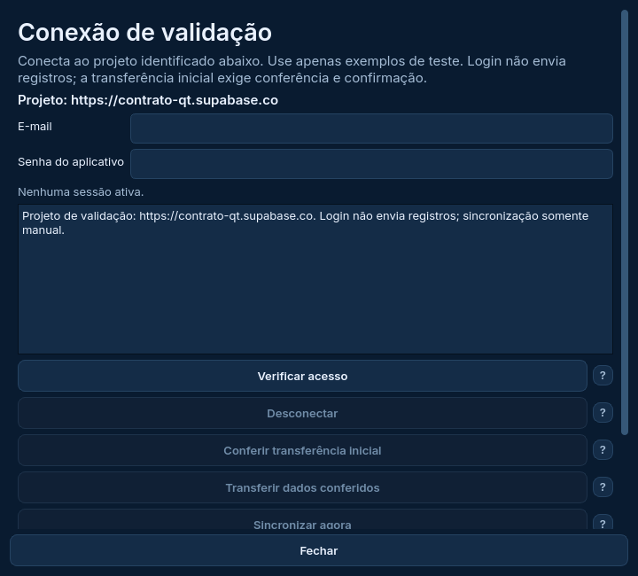

# Entrada gráfica de validação online

A entrada separada está implementada para validar o cliente real em um projeto Supabase exclusivo de testes. Não é lançamento da 2.0. A versão 1.7.1, o estudo simulado e a PWA permanecem preservados.

## Abrir

Use a cópia separada do estudo, na branch `reforma/estudo-interface`, atualizada com `git pull --ff-only origin reforma/estudo-interface`. Não execute estes comandos na instalação 1.7.1; o [guia do VS Code](../prototipos/reforma/GUIA_VSCODE.md) explica a cópia de estudo.

Prepare antes o [perfil offline](PREPARACAO_VALIDACAO.md), indicando um projeto de teste diferente do projeto de origem. O perfil não pode ser alterado. A nova pasta de execução deve ficar fora dele e dos dados do programa em uso.

```powershell
.\.venv-estudo\Scripts\python.exe executar_validacao.py `
  --perfil "D:\Feira2026\perfil-teste-novo\perfil" `
  --pasta-execucao "D:\Feira2026\execucao-online-teste"
```

Na primeira abertura, copia somente tema, período e configuração pública. Não copia banco nem sessão de `preservados`. O banco da execução começa vazio. A pasta pode ser reaberta com o mesmo comando; perfil, configuração/projeto e vínculo do banco são conferidos antes de carregar a interface. Pasta já existente sem marca, projeto alterado, sobreposição ou links são recusados. Não use as pastas de dados da instalação 1.7.1.

O aplicativo não descobre seus projetos de produção. Cabe escolher um projeto separado e conferir a URL exibida antes do login. Não forneça sua conta de produção para este ensaio. Use somente exemplos fictícios; nenhum histórico pessoal é importado automaticamente.



A imagem usa somente um projeto fictício e não contém credenciais.

## Login e envio

1. A janela de conexão exibe a URL do projeto. Digite o e-mail e a senha do aplicativo criado **nesse projeto de teste**, não as credenciais da conta administrativa do Supabase. A chave pública vem do perfil e não é um substituto para login/autorização.
2. **Verificar acesso** autentica e confere a autorização. Não transfere registros. A senha fica mascarada e o campo é limpo ao enviar; não é persistida. Somente a sessão renovável é protegida pelo DPAPI do Windows, na pasta de execução.
3. Reabrir não acessa a rede. **Retomar sessão salva** renova e verifica a autorização explicitamente. Sem essa verificação, a sessão não libera operações. Uma tentativa de novo login malsucedida mantém a sessão anterior apenas como pendente, para retomar ou desconectar.
4. Cadastre exemplos manualmente. **Conferir transferência inicial** cria cópia e compara, sem transferir. **Transferir dados conferidos** exige confirmação e mostra o projeto. Cancelar não envia; se os dados mudaram, o núcleo exige nova conferência.
5. Após a transferência, **Sincronizar agora** estabelece o vínculo. Depois disso os envios/recebimentos continuam manuais; salvar uma venda não envia automaticamente. Conflitos mantêm conferência, escolha e reconferência existentes.

Esta entrada não tem controle de simulação nem atualizador fictício. A importação/restauração de bancos é bloqueada nesta validação, para não transportar o arquivo preservado para outro projeto. O pacote e o atualizador reais continuam pendentes. Drive usa somente o conjunto separado existente do estudo se for configurado explicitamente; não foi conferido online nesta entrega.

## Projeto e SQL

O ensaio externo exige projeto de teste, usuário do aplicativo e SQL/políticas compatíveis com a aplicação. A pasta [supabase](../supabase) contém os roteiros versionados; não cole esses roteiros no projeto de produção para executar este teste. A instalação e a auditoria do projeto separado serão a próxima conferência orientada. Nenhuma conta externa ou senha foi acessada pelo agente nesta entrega.

## Testes

[Treze testes novos](tests/test_entrada_online_qt.py) exercitam o modo online com o cliente existente e TLS loopback: login sem transferência, senha limpa, cancelamento/confirmação com projeto identificado, envio manual, retomada/autorização, falhas, perfil/banco de outro projeto e ausência de controles fictícios. Dois processos novos abrem e reabrem a entrada com `--captura`, banco vazio e HTTP bloqueado. Os testes anteriores continuam preservados.

A primeira regressão completa encontrou cinco falhas nos cenários automáticos do estudo simulado: o modal da conexão permanecia visível depois de fechar o principal. [Resultado reprovado preservado](resultados/online-reprovado-linux). O fechamento agora encerra os diálogos-filhos depois de confirmar que não há operação ativa; há guarda para reentrada. A reprodução isolada com os testes online seguidos da consulta automática passou, sem modal remanescente. Um teste novo protege esse encerramento. A rodada anterior não foi tratada como aprovação. A repetição Linux passou: **167 testes Qt executados, 165 aprovados e dois DPAPI ignorados; 200 estáveis aprovados e dois nativos ignorados; 31/31 protótipos**. Sem falhas ou erros; R01–R06 conformes. [Evidências locais](resultados/online-linux), aplicação `f53cced` e ajuste de expectativa `ecdc773`. **Windows final:** 167/167 Qt, 202/202 estáveis e 31/31 protótipos aprovados, sem falhas, erros ou ignorados. R01–R06 conformes. [Evidências da execução 40711385643](resultados/windows-40711385643), revisão `ecdc773`; Python 3.13.16, SQLite 3.50.4 e Qt 6.10.2. A resolução da VM foi restaurada. O TLS local usa o servidor fictício de contrato; não comprova o SQL, a RLS, a autorização ou concorrência do Supabase real. A matriz continua 26 I/quatro S até validar os serviços externos.

## Próxima atividade

Conferência online com o usuário em projeto separado: instalar/auditar os roteiros adequados, verificar login, migração, duas direções, conflitos/recibos e datas de compras/fechamentos. Depois permanecem conferências Windows/DPI/acessibilidade, pacote Qt e ensaio da atualização 1.7.1 → 2.0 com recuperação, antes da aprovação/publicação. PWA segue na Etapa 7.

## Projeto de teste recém-criado — preparação guiada

O usuário informou em 28/10/2026 que criou um projeto separado. A conferência externa ainda não foi executada pelo agente. No dashboard, confirme o **projeto de teste** antes de cada operação:

1. Em **Authentication → Users → Add user → Create new user**, crie o usuário do aplicativo de teste e confirme o e-mail nessa tela, se a opção estiver disponível. Pode usar o mesmo e-mail em projetos diferentes; a senha é a definida neste projeto. Não envie senhas.
2. Para um projeto vazio, no **SQL Editor desse projeto**, execute separadamente, na ordem, os arquivos `001_vendas.sql` a `006_datas_compras.sql` de [supabase/migrations](../supabase/migrations). Aguarde sucesso de cada arquivo. Se houver erro, interrompa e envie a mensagem antes de continuar. Não execute no projeto em uso pelo programa 1.7.1. Se o Table Editor já mostrar tabelas do aplicativo ou se alguma integração já aplicou migrations, faça primeiro a auditoria e confira o estado antes de repetir os scripts.
3. Autorize somente o usuário de teste. No bloco abaixo, troque `SEU_EMAIL_DE_TESTE` pelo e-mail criado. O bloco recusa trocar um proprietário já configurado; não desativa RLS ou altera vendas.

```sql
do $$
declare
    usuario uuid;
begin
    select id into strict usuario
    from auth.users
    where lower(email) = lower('SEU_EMAIL_DE_TESTE');

    if exists (select 1 from private.app_config where singleton and owner_id <> usuario) then
        raise exception 'Já existe outro proprietário. Nada foi alterado.';
    end if;

    insert into private.app_config(singleton, owner_id)
    values (true, usuario)
    on conflict (singleton) do nothing;
end $$;
```

4. Execute os blocos de [auditoria somente leitura](../supabase/auditoria_somente_leitura.sql) nesse mesmo projeto. Envie apenas os resultados de permissões/políticas, sem senhas, tokens ou chaves. A validação precisa conferir o servidor real antes de considerar RLS aprovada.
5. A URL HTTPS e a chave **Publishable/anon** desse projeto são usadas localmente no preparador de perfil; não use secret/service_role. Após preparar e abrir a entrada separada, valide primeiro o login, sem vendas reais. Os exemplos e envios serão conferidos na sequência.

Criar o projeto não atualiza o PWA nem muda o projeto de produção. A conferência PC/PWA exigirá posteriormente uma instância web de testes configurada para esse projeto; não trocar a configuração do site em uso.

### Histórico da revisão Windows desta entrega

As execuções 40709506875 (`ffecb9b`) e 40710160241 (`dad9eb2`) também reproduziram as cinco falhas por modal remanescente. Houve ainda uma expectativa incorreta no teste de pasta: o Windows forneceu `RUNNER~1`, enquanto a guarda retornou o caminho canônico `runneradmin`. A comparação do teste passou a usar `resolve()`; a guarda e a identidade do perfil não foram flexibilizadas. As rodadas reprovadas não aprovam a entrega. A validação final usa a correção dos modais e a comparação normalizada.

A execução intermediária 40710852322 (`f53cced`) já eliminou as cinco falhas funcionais; restava só a expectativa de caminho canônico. A final 40711385643, com `resolve()` no teste, passou integralmente. A entrada está pronta para a conferência externa, mas **nenhum teste no projeto Supabase do usuário foi executado pelo agente**.
